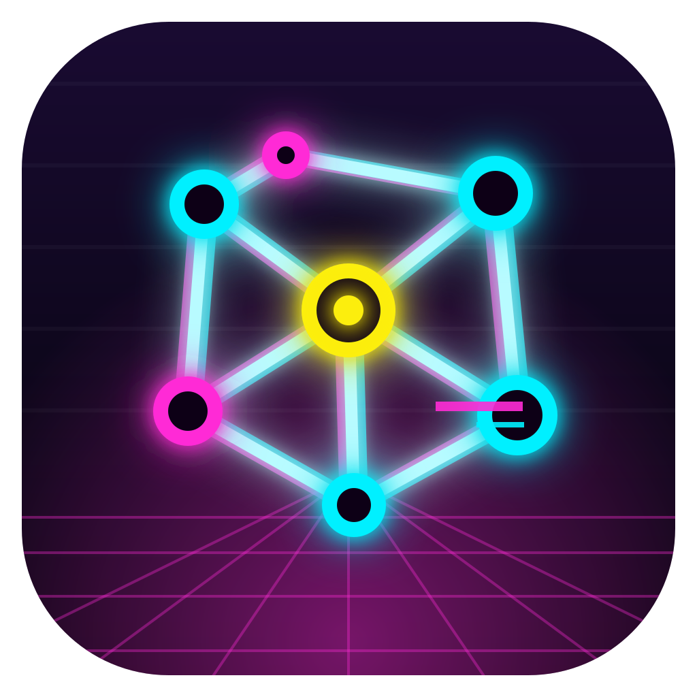

<p align="center">
  
</p>

<h1 align="center">L-Brain</h1>

<p align="center">
  <b>Your own knowledge base: one card per idea, and whether you still remember it.</b><br>
  <sub>Part of <a href="../README.md">LoreForge</a> · local-first · interface in Traditional Chinese</sub>
</p>

<p align="center"></p>

## Features

- **Cards as files**: one JSON file per card; your learning state is kept separately per person.
- **Remembering, not just storing**: a card is asked again after 1 and 3 days, then 30 and 90; forget it and it starts over.
- **Graph**: the whole base or one card's neighbourhood, coloured by domain, with playback of how it grew.
- **Shared with the other apps**: L-Reader marks what you know, L-Paper skips terms you remember, L-Echo quizzes you, L-Deck shows due cards.
- **Pending inbox**: cards drafted by another app wait here until you confirm, edit, merge or discard them.
- **Reminders**: due-card notifications and an optional daily e-mail.

## Run

```sh
cargo run -p kb-server                     # http://127.0.0.1:7700
../scripts/install-apps.sh L-Brain         # the Mac app
scripts/install-launchd.sh                 # optional: start the server at login
```

## How to use

- **New card** (新增知識卡): title, aliases, domain, summary, and a body in Markdown + LaTeX. `[[Title]]` links to another card.
- **Review** (複習): answer remembered / forgot / unfamiliar for each due card.
- **Graph** (圖譜): hover for a summary, click for details, ⌘-click to open; the tag bar lights up one topic.
- **Settings** (gear): theme, models, shortcuts, notification times, e-mail.

## Your data

- Cards: `private/KnowledgeBase/` (`nodes/`, `progress/<you>/`, `tags.json`, `kinds.toml`).
- Settings and the SMTP password: `~/Library/Application Support/KnowledgeBase/` and the keychain, never in a repo.

## Limits

- Household (shared) spaces are not finished.
- At most twelve domain colours.
- iCloud image storage, Gmail delivery and start-at-login are untested on real hardware.

Detailed guide, data formats and API (繁體中文): [`docs/guide.zh-TW.md`](docs/guide.zh-TW.md)

## Development notes

Developed by ellrin with Claude (Anthropic); the code is written in claude.ai and Claude Code.
