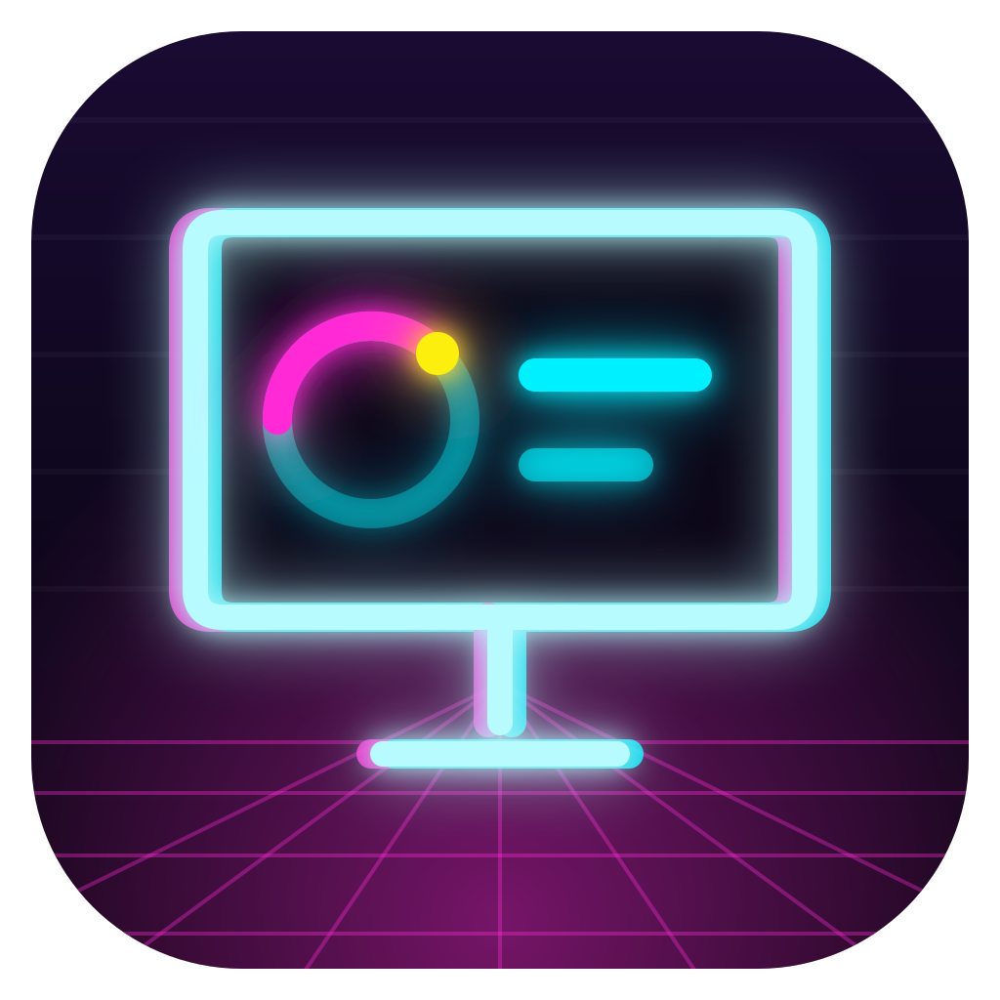

<p align="center">
  
</p>

<h1 align="center">L-Deck</h1>

<p align="center">
  <b>Your macOS desktop as a canvas of widgets you write yourself.</b><br>
  <sub>Part of <a href="../README.md">LoreForge</a> · local-first · interface in Traditional Chinese</sub>
</p>

<p align="center"></p>

## Features

- **Widgets are JS, themes are CSS**: save a file and the desktop updates.
- **Built-in widgets**: system monitor, clock, alarm, calendar with reminders, news, launcher, and L-Brain's card carousel with due-card notifications.
- **A layout per display resolution**: an unarranged screen borrows the nearest layout, scaled.
- **Light on resources**: system numbers come from syscalls; sampling pauses when the desktop is covered.

## Install

```sh
./build.sh install       # builds and installs ~/Applications/L-Deck.app, then starts it
```

## How to use

- Menu-bar icon ▦: edit layout (⌘E), add widget, switch theme, reload, start at login, quit.
- Edit mode: drag to move, resize from the corner, ✕ to remove, Esc to finish.
- New widget: copy `desktop/widgets/_template.js` (no leading `_`). New theme: copy a CSS file in `desktop/themes/`.
- Design in a browser: `cd desktop && python3 -m http.server 8765`, then open http://localhost:8765 (fake data).
- Log: `~/Library/Logs/NeonDeck.log`.

## Your data

- `desktop/layout.json` (your layout and widget settings) is personal and not in git.

## Limits

- Main display only; alarms need L-Deck running and the Mac awake.
- With ad-hoc signing, macOS may ask again for calendar and reminder access after a rebuild.

## Development notes

Developed by ellrin with Claude (Anthropic); the code is written in claude.ai and Claude Code.
