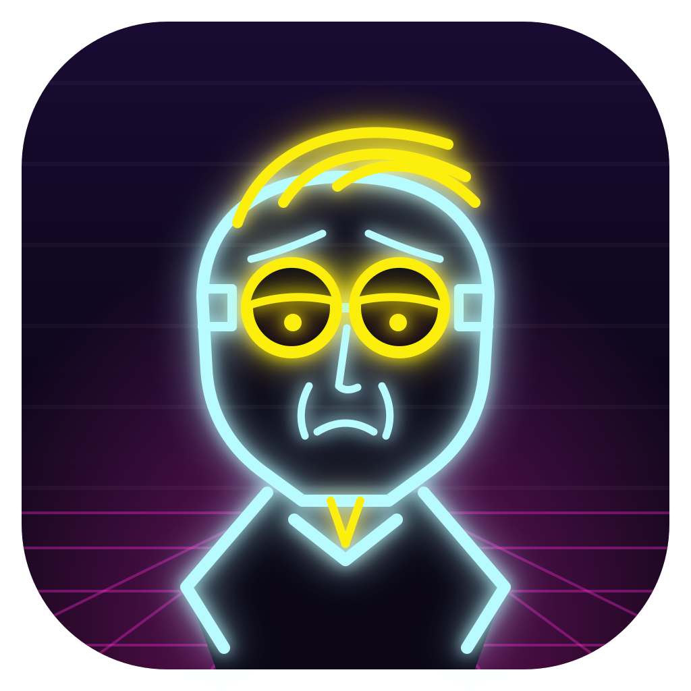

<p align="center">
  
</p>

<h1 align="center">L-Echo</h1>

<p align="center">
  <b>A study partner in the corner of your desktop that knows your knowledge base.</b><br>
  <sub>Part of <a href="../README.md">LoreForge</a> · local-first · interface in Traditional Chinese</sub>
</p>

<p align="center"></p>

## Features

- **A bubble that opens into a scene**: a full-body character on the left, the conversation on the right.
- **Knows your cards**: each answer brings the related L-Brain cards and how well you know them; ask it to quiz you or pick today's review.
- **Turns talk into material**: summarise the chat into a LaTeX note for L-Paper, or cards for L-Brain's pending inbox. Nothing is saved until you confirm.
- **Voice** (macOS): hold to talk or keep listening; replies can be read aloud.
- **Forgets by default**: the conversation itself is never written to a file.

## Run

```sh
cargo run -p loreecho                      # the desktop bubble
cargo run -p le-server                     # browser mode: http://127.0.0.1:7860
../scripts/install-apps.sh L-Echo          # the Mac app
```

## How to use

- **Click the bubble** to open, drag to move; **Esc** closes (and clears the chat). Global shortcut: Alt+Space.
- **Enter** sends, **Shift+Enter** for a new line; **＋** starts a new conversation.
- **List button**: make a note, make cards, jot an idea.
- **Name tag**: switch character.

## Make it yours

- A character is a folder: `private/LoreEcho/characters/<id>/` with `character.toml` (personality, background, speech style, voice), avatar and full-body art for each state, and an optional theme song. Copy the example to start.

## Limits

- In development; voice is macOS only.
- Through a Claude subscription replies arrive all at once.
- Marking a card as remembered needs L-Brain open.

Detailed guide and API (繁體中文): [`docs/guide.zh-TW.md`](docs/guide.zh-TW.md)

## Development notes

Developed by ellrin with Claude (Anthropic); the code is written in claude.ai and Claude Code.
