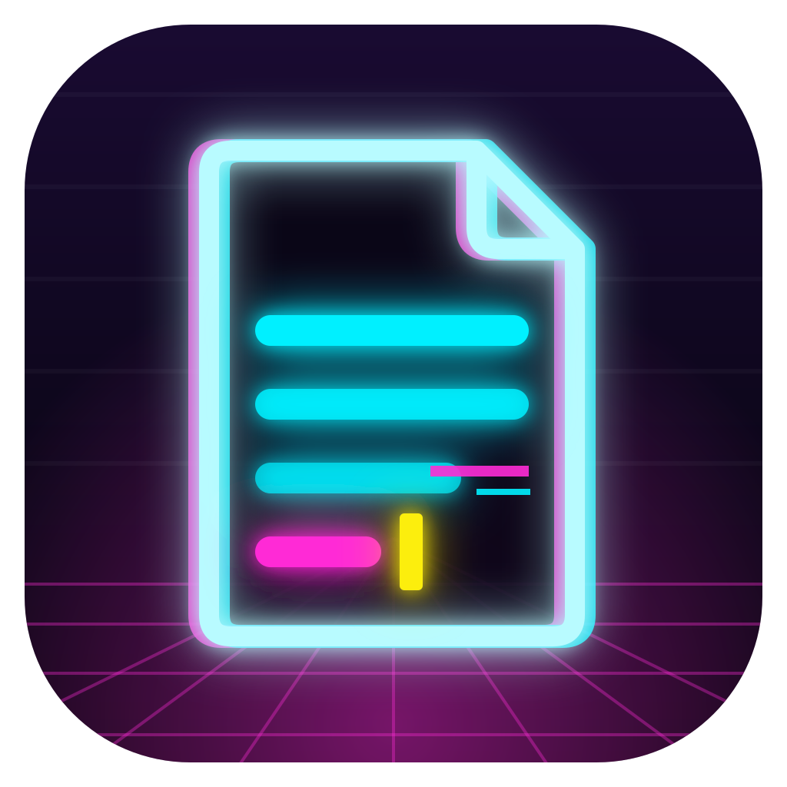

<p align="center">
  
</p>

<h1 align="center">L-Paper</h1>

<p align="center">
  <b>A LaTeX paper editor with no second window, and one registry for every symbol and equation.</b><br>
  <sub>Part of <a href="../README.md">LoreForge</a> · local-first · interface in Traditional Chinese</sub>
</p>

<p align="center"></p>

## Features

- **Edit on the typeset page**: text, equations, tables, figures and citations change where you see them. No source pane, no preview window; the files stay plain LaTeX.
- **Notation registry** (對照表): every symbol, equation, abbreviation and label is registered once and inserted from there. A check (校對) finds undefined, unused or inconsistent entries and jumps to each one.
- **Shared across apps**: the global registry is used by L-Slide and L-Brain too; AI drafting and polishing must keep its macros intact.
- **Your sentence library**: drafting follows your own patterns; hard style rules are checked by code.
- **Journal templates**: each carries its rules (`Fig.` or `Figure`, caption position, page and word limits).
- **In and out**: open LaTeX or Word; export PDF, LaTeX or Word.

## Run

```sh
cargo run -p pc-server                     # http://127.0.0.1:7878
../scripts/install-apps.sh L-Paper         # the Mac app
```

Without a workspace it opens demo data. The first-run setup (gear) connects your private repo, a local model and Claude.

## How to use

- **Home**: write a paper (寫論文), write a book (寫書), open LaTeX or Word, notes.
- **Right-click a paragraph**: cite, reference a figure or table, add a figure or table; with a selection, polish (潤飾) or save the sentence pattern.
- **對照表** (top bar): the registry; insert symbols and equations, run the check.
- **⌘S**: save, commit and push your workspace in the background.
- **Review mode** (審閱): tracked changes and comments; exported to Word as real revisions.

## Your data

- Workspace (your private repo): `profile/` sentence patterns and rules, `style/`, `publishers/` templates, `papers/`.
- Registry: `private/shared/notation.json` (global) plus `notation.json` in each paper.
- Claude API key: the keychain only.

## Limits

- Early development.
- PDF export needs TeX: MacTeX, or BasicTeX plus the packages listed in the detailed guide.

Detailed guide, templates, Git sync and API (繁體中文): [`docs/guide.zh-TW.md`](docs/guide.zh-TW.md)

## Development notes

Developed by ellrin with Claude (Anthropic); the code is written in claude.ai and Claude Code.
