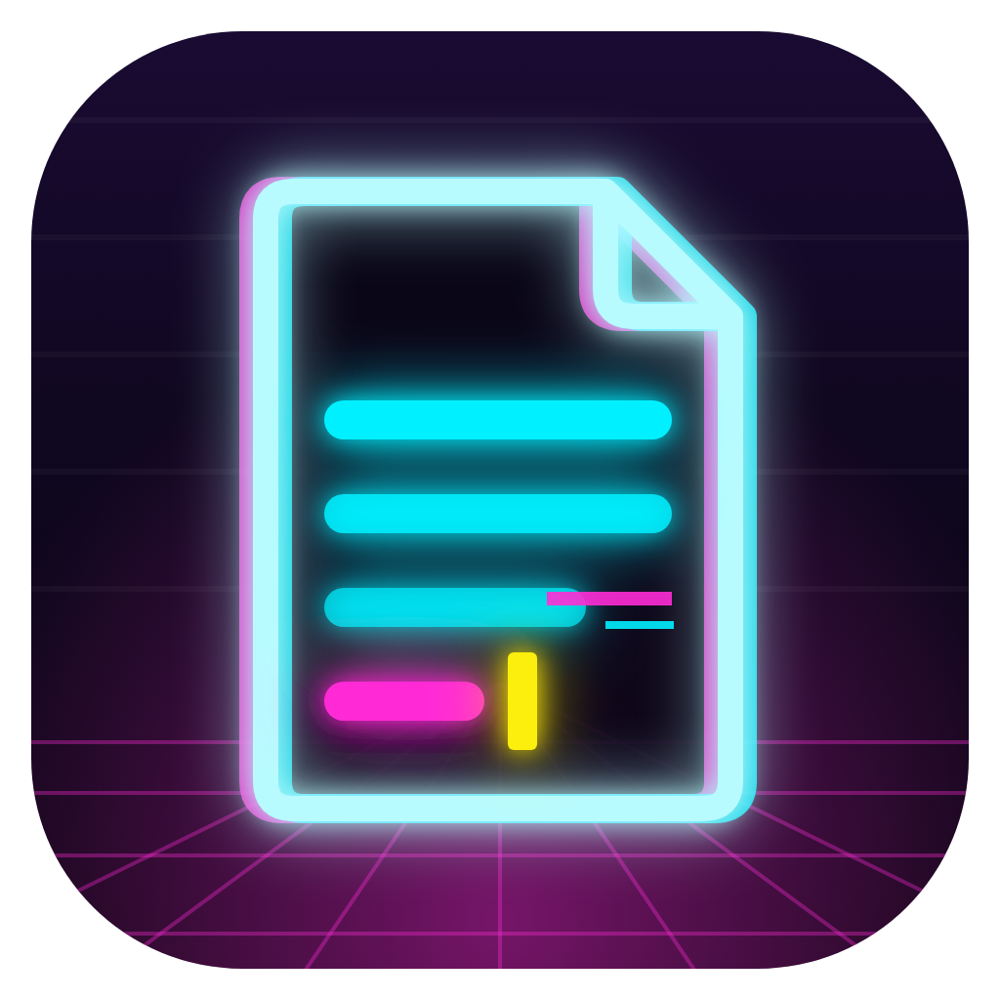

<p align="center">
  
</p>

# PaperComposer

本機運作的論文寫作編輯器：在排版好的畫面上直接編輯，用你自己的句型資料庫輔助寫作與檢查段落，輸出期刊要求的 LaTeX 或 Word。

> 開發初期。已完成：句型資料庫讀取與驗證、句型檢索、硬規則檢查、一次性段落生成（語氣鎖定）、桌面殼與介面雛形。

## 執行

需要 [Rust](https://rustup.rs)（1.88 以上）。共用模組 `commons`（`lore-llm`：模型與任務路由；`lore-gitsync`：Git 同步）以相對路徑引用，要放在這個 App 資料夾旁邊：`<上層>/commons` 與 `<上層>/PaperComposer/public`。

**桌面版**

```sh
cargo run -p papercomposer
```

- Windows：需要 Visual Studio Build Tools（C++）與 WebView2（Windows 10/11 已內建）。
- macOS：需要 Xcode Command Line Tools。
- 打包安裝檔：見下方「自己打包成 App」。
- 圖示：原始檔為 `apps/desktop/icons/logo.svg`，對應的 1024px 圖為 `logo.png`。換圖後於 `apps/desktop/` 執行 `cargo tauri icon icons/logo.png` 重新產生各尺寸。

**瀏覽器開發模式**（改介面時最快）

```sh
cargo run -p pc-server
```

開啟 <http://127.0.0.1:7878>。

沒有指定工作區時，兩種模式都使用內建示範資料（`../private-example/PaperComposer/`），右上角顯示「連接工作區」。

## 自己打包成 App

這個 repo 只提供原始碼，要不要包成 App、包成哪一種由你決定。先安裝打包工具（一次即可）：

```sh
cargo install tauri-cli --version "^2" --locked
```

**macOS（`.app`）**

```sh
cd apps/desktop
APPLE_SIGNING_IDENTITY="你的簽章名稱" cargo tauri build --bundles app
cp -R ../../target/release/bundle/macos/PaperComposer.app /Applications/
```

Claude 的 API key 存在鑰匙圈。macOS 依程式的簽章決定誰能讀它：**沒有簽章**的 App 每次重新打包都被當成另一個程式，開啟時會一直要求輸入登入密碼。給 App 一個固定的簽章就只會問一次（按「永遠允許」），之後更新也不再問：

- 自己用：建立免費的自簽憑證即可。

  ```sh
  openssl req -x509 -newkey rsa:2048 -keyout key.pem -out cert.pem -days 3650 -nodes \
    -subj "/CN=My Local Code Signing" -addext "keyUsage=critical,digitalSignature" \
    -addext "extendedKeyUsage=critical,codeSigning" -addext "basicConstraints=critical,CA:false"
  openssl pkcs12 -export -legacy -out id.p12 -inkey key.pem -in cert.pem -passout pass:tmp
  security import id.p12 -k ~/Library/Keychains/login.keychain-db -P tmp -T /usr/bin/codesign
  rm key.pem id.p12
  ```

  之後以 `APPLE_SIGNING_IDENTITY="My Local Code Signing"` 打包。系統不信任自簽憑證沒關係，`codesign` 照樣能簽。
- 給別人下載：需要 Apple Developer 帳號的 Developer ID 憑證並經過公證（notarize），別人的 Mac 才能直接開啟；設定方式見 [Tauri 的 macOS 簽章說明](https://v2.tauri.app/distribute/sign/macos/)。

**Windows（`.msi` / `.exe`）**

在 Windows 上（需 Visual Studio Build Tools 的 C++ 與 WebView2）：

```powershell
cd apps\desktop
cargo tauri build
```

安裝檔在 `target\release\bundle\msi\` 與 `target\release\bundle\nsis\`。Windows 的 API key 存在「認證管理員」，不受簽章影響；沒有簽章時 SmartScreen 第一次會警告，按「其他資訊 → 仍要執行」。

## 你的私人工作區

句型、模板、論文都是個人資料，**放在你自己的私有 repository**，不要放進這個 repo。結構如下（空白範本見 [`../private-example/PaperComposer/`](../private-example/PaperComposer/)；填好虛構內容的完整範例見 [`example-workspace/`](example-workspace/README.md)）：

```
your-private-repo/
  profile/      句型、用詞、規則、範例段落、公式片段
  publishers/   各出版社的 .cls、範例 .tex 與模板設定
  papers/       每篇論文一個資料夾（main.tex、sections/，以及 paper.toml：Key value 與作者）
  prompts/      自訂提示詞（可選）
  config.toml   App 記住的介面設定：紙張、縮放、引擎、上次開的論文（配色是所有 App 共用的，存在 LoreForge 的 private/shared/ui.toml）
```

介面設定存在工作區的 `config.toml`（`[ui]`），跟著工作區一起同步，換一台電腦打開也是同樣的樣子；每次開啟時以它為準。

第一次開啟 App 會彈出 **AI 與同步** 視窗（之後點右上角的「AI」開啟），三個步驟都可略過：

1. **工作區與同步**：三選一，每位使用者都指向**自己的**私有 repo，App 不綁定任何特定帳號
   - 建立新的：先在 GitHub 建立一個空白的 **private** repo（旁邊的外連圖示會開啟建立頁面），貼上網址並選擇存放位置；從範本建立資料夾、`git init` 並 push。網址留空則只存在這台電腦
   - 從 repo 下載：第二台電腦用，clone 你的私有 repo；若偵測到是**公開** repo 會提醒先改成 private
   - 開啟資料夾：已經在電腦上的工作區；缺少的資料夾與範本檔會自動補上（不覆蓋既有檔案）
   - 需要同步時才會出現 Git 檢查：是否安裝 Git、commit 作者名稱與 email
2. **本機模型**：偵測記憶體（含 Mac 統一記憶體與 NVIDIA 顯示卡），標示推薦與放不下的模型。按「準備下載」先列出要下載的檔案、大小與來源，**確認後才下載**；下載完成自動啟動並設為預設
3. **Claude**：兩種連線方式，自己選、隨時可切換（右側引擎的 Claude 選單也能切換）
   - **登入帳號（訂閱）**：透過 [Claude Code](https://code.claude.com/docs/en/setup) 用你的 claude.ai Pro／Max 帳號，費用算在訂閱額度內。App 會偵測是否安裝、顯示官方安裝指令、按一下用瀏覽器登入並自動偵測完成。每次呼叫都在空的暫存資料夾執行 `claude -p`，關閉所有工具、不載入任何外掛設定，並移除 `ANTHROPIC_API_KEY` 以免改走 API 計費。只適合自己使用
   - **API key**：按外連圖示開啟 Anthropic Console 建立 key，貼回來儲存（只存在系統金鑰圈），按用量計費

   兩種方式都有「測試連線」，會標明走的是訂閱還是 API。寫作、拆解、段落檢查都使用右側選的引擎，檢索、提示詞與驗證都相同

也可以手動指定位置（擇一）：

- 環境變數 `PAPERCOMPOSER_WORKSPACE=/path/to/your-private-repo`
- 設定檔 `PaperComposer/config.toml` 寫入 `workspace_path = "/path/to/your-private-repo"`
  （Windows：`%APPDATA%`；macOS：`~/Library/Application Support/`；Linux：`~/.config/`）

設定檔在所有 repo 之外，路徑不會被 commit。欄位說明見 [`../private-example/PaperComposer/profile/README.md`](../private-example/PaperComposer/profile/README.md)。

## Git 同步

工作區是 Git repository 時（建議是你的私有 repo）：

- **開啟 App**：自動 pull。只做 fast-forward；兩邊都有新 commit 時會提示你按同步。
- **Ctrl+S**（或點狀態列的同步狀態）：commit 所有修改並 push。commit 訊息依修改的檔案自動產生，例如 `Update my-paper (method, result); profile (phrases)`。
- **另一台裝置先推了**：先抓遠端、把你的 commit 接在遠端之後再 push（不會先推一次失敗）；若兩邊改到同一句，**中止並還原**，你的修改仍保留在本機，不會自動合併。永遠不會 force-push。
- **commit 前檢查金鑰**：新增的內容看起來像 API key 或 token 時，拒絕 commit。

同步由共用模組 `lore-gitsync` 處理，使用系統安裝的 `git`，登入交給你電腦上的 Git 憑證管理（Windows 為 Git Credential Manager），App 不保存 Git 密碼。作者名稱沿用你的 `git config user.name` 與 `user.email`。

## 新論文

論文選單的「新論文」開啟五個步驟的視窗。第 3 步的 Key value 填好才能往下；第 4、5 步可以留白，直接按「下一步」。「建立論文」只在最後一步出現，旁邊是資料夾名稱：依標題（沒有標題時用 Key value）自動產生，例如 `explainable-hip-fracture-detection-attention`，可以改，不會和現有的論文重名。

1. **版型**：選期刊或研討會的模板，或空白 article。
2. **作者**：從作者資料庫勾選、排順序，標記通訊作者與同等貢獻。資料庫在 `profile/authors.csv`（姓名、email、ORCID、所屬機構、角色）與 `profile/affiliations.csv`（系所、機構、城市、國家），姓與機構必填，其他可空著；在這裡新增的人會存進資料庫，下一篇直接選，也可以在「資料庫」視窗的「作者」「機構」分頁編輯。作者區塊依版型的寫法產生，不經過模型：Springer Nature（`\author[1]{\fnm{}\sur{}}`、`\affil`）、Elsevier（`elsarticle` 的 `\corref`；`cas-dc` 的 `\cormark` 與 `[orcid=]`）、IEEE 期刊（`\thanks{… is with …}`）、IEEE 會議（`\IEEEauthorblockN/A`）、LNCS（`\inst`、`\orcidID`、`\institute`），其他 class 用通用的 `\author{Name\\ 機構 \and …}`。範例裡的作者整段換掉，其餘不動。
3. **Key value 與大綱**：
   - **Key value 必填**：這篇論文通篇要強調的一件事，可以是願景（例如「提升 XX 效能」）。中文最多 50 字、英文最多 30 個單字，存在 `paper.toml`；論文上方會一直顯示，點一下可修改。匯入現有論文時也要填。
   - **大綱（選填，需要 Claude）**：條列章節與要說的事，Claude 依 Key value 給 3 個標題建議，並排出 section／subsection，每段最多兩句話說明這裡要寫什麼（寫在內文，之後自己改）。有期刊模板時依期刊的章節順序；勾選套用就取代模板的範例章節，前後的標題區與參考文獻區保留。

4. **圖表（選填）**：已經有的結果先放進來。
   - **表格**：從 Excel 或 Google 試算表選取儲存格直接貼上（也可以貼 CSV 或 Markdown 表格），第一列是表頭，下方即時預覽列數與欄數。選要放的章節（大綱架構的章節、模板的章節或空白論文的章節）和樣式（預設用這個期刊的：Springer Nature、Elsevier、IEEE、LNCS、CVPR，其他用 booktabs）。
   - **圖片**：PNG、JPG、PDF 或 EPS，存進論文的 `figures/`（檔名整理成 `fig1-原檔名.png`），以 `\includegraphics[width=\linewidth]` 放進 `figure` 環境。
   - **標題（caption）自動產生**：留白時，貼完表格或選好圖片後由右側選的寫作引擎（本機模型或 Claude）依表頭、列名寫一句標題，不寫結果與數字；也可以按標題旁的 AI 重寫。圖片只看得到檔名，檔名看不出內容時不會亂編，請自己填。建立時還空著的會先補上。
   - 可調整順序；建立時依序放在各章節的最後，產生 `\caption`、`\label{tab:…}`／`\label{fig:…}`，需要的套件自動加進 `main.tex`；之後在頁面上照常編輯。
5. **文獻（選填，需要 Claude）**：把想引用的文章一次貼上，可以夾雜備註（見下方「文獻」的「貼上想引用的文章」）。Claude 先算出有幾篇，再三篇一組查證、建檔、加標籤存進文獻庫，顯示進度條；可以邊匯入邊回到其他步驟。你對每篇的備註（例如「需注意 · Methods · 只支撐…」）會記成這篇論文的引用用途（`citations.csv`）。

**Key value 是生成與檢查的約束**：生成段落時放進規則；檢查加了一條軟規則 R106（`supports_key_value`），判斷段落、圖表、摘要、contribution、討論是否離題。它是黃燈：延伸討論不一定完全對齊主題，不必每段都綠燈。

**清單**：寫作工具列有「項目清單」（`itemize`）和「編號清單」（`enumerate`，例如 *Our contributions are as follows:* 後面列點）。

**收藏句型**：在頁面上（或正在編輯的段落裡）選取喜歡的句子，按寫作工具列的星號。右側選的引擎把它拆成句型與片語，勾選後按「加入句型庫」就直接存進 `phrases.csv`／`expressions.csv`，不用開資料庫、也不用另外儲存。內容相同的句型不會重複加入；資料庫視窗有未儲存的修改時，改為加進編輯中的表格。

**生成段落的限制**：句型依重點的用字檢索。重點用中文寫、段落要英文時，中文重點對不到英文句型，生成時幾乎不會用到你的句型；想要段落有自己的語氣，重點請用英文寫。

## 討論草稿

已經做完實驗、有實驗記錄時，用對話把它變成論文草稿。開啟論文後按上方的 AI 圖示（或檔案選單的「討論草稿…」）。所有內容存在論文資料夾的 `draft/`（`session.json`、`transcript.jsonl`、`records/`），隨工作區同步，可以隨時接著做。

| 步驟 | 內容 |
|---|---|
| 1 主題 | Key value，加上「有意思的地方」的假說：讀者已經承認什麼、你的轉折是什麼；列出本篇文獻（標籤、你寫的用途、DOI 連結），要加文獻在文獻視窗貼上，照常一篇一篇查證 |
| 2 實驗記錄 | 上傳 `.md .txt .csv .tsv .json .log` 或 PDF（Excel、Word 請另存 CSV／純文字）。Opus 整理成實驗清單、**時間線**（先試了什麼、看到什麼、改了什麼）、**你在記錄裡寫下的想法**（問答時當作選項）、**結果表格**（數字照抄，缺的標「—」，可一鍵插入論文，用期刊的表格樣式），並列出記錄與論文既有表格對不上的數字。論文裡已有的表格、圖、文獻自動帶入，不用重貼 |
| 3 題組 | 依 Introduction、Methods、Results、Discussion、Conclusion 規劃題組，每組要整理出說明、動機、結論；Results 一張圖表一組；可以直接修改、增刪 |
| 4 對話 | 一次一題；回答「不確定」時給 2–4 個選項（先用你記錄裡的想法）。動機牽涉前人研究或公認做法時，順便問要對應哪幾篇文獻（依標籤與用途配對）；Results 先問「表 X 是主表嗎、想比較什麼、強調什麼」。右側狀態表顯示每一項還缺什麼，一組問夠了就提示可以結束（由程式依視角判斷，不是模型感覺）；超過題數上限會提示略過 |
| 4.5 主張 | 主張登記：每個主張只在一個章節完整說一次，其他地方只回扣 |
| 5 校正 | 檢查題組順序是否形成線性敘事，提出移動、拆分、合併、合成一張表的建議，逐條採用或不採用 |
| 6 大綱 | 逐段大綱：段落類型、組成（事實 → 理由層級 → 結論）、中文說明與英文重點、要引用的文獻（遵守你寫的用途，例如「只用在 Methods」）；逐章寫意見修改 |
| 7 草稿 | 逐章用句型庫生成（與「寫作」相同的語氣鎖定），加上大綱的組成、你的風格筆記與 `\cite{}`；會參考同章已寫的段落與校正時採用的建議，避免重述 |
| 8 審稿 | 找矛盾、宣稱過度、缺數字、不可能的數字、空泛句、重複、埋掉的發想、缺理由的設計、引用超出用途或該引未引；需要你補充的可以「回到對話追問」 |

| 9 修訂 | 論文寫好之後要補東西（一審要求外部驗證、老師要多一張圖、多引兩篇）：寫下要補什麼，可附新圖檔、從文獻庫選要加的文獻（會記進本篇引用）。先開一組對話，討論它要支撐什麼、放在哪一段（選項直接用段落編號）、會影響哪些地方、圖的 caption；再由 Opus 產生具體修改（插在某段之前／之後、取代某段、加在章節最後），每一項附原段落與理由，逐項「套用」或「不採用」。套用前會確認那一段還是原來的文字，改過就不寫；對不上的修改與需要你處理的連帶影響列在「還要注意」 |

**對照表（`lore-notation`）**：討論草稿與修訂的每一步都會帶上你的對照表（`profile/notation.json` 加上論文的 `notation.json`）：符號用登記的巨集、圖表公式一律 `\ref{…}`、縮寫第一次出現要展開、數學一律在 `$…$` 裡。每段草稿與每項修訂寫完都跑一次對照表檢查：手打的「Table 1」或不存在的標籤會自動重寫一次，其他問題（縮寫沒展開、符號未定義等）列在段落下方或「還要注意」；對照表裡沒有的新符號可以一鍵登記（標為「待確認」，到對照表補上意思）。

**文獻用途會在對話裡長出來**：審稿說某篇的引用超出你寫的用途時，你在對話裡說明那篇其實還能支撐什麼（例如作者設計方法時觀察到的某個事實），這句會加進那篇在 `citations.csv` 的用途，之後的大綱與審稿就照新的用途判斷。

**什麼重要由你決定**：程式本身是中性的，要追問什麼、回答怎麼判讀、什麼時候算問夠，寫在工作區的 `lens/`；你的寫作風格（段落類型、比例、要避免的習慣、範例段落）寫在 `style/`。兩者都是你私人 repo 的檔案，格式見 [`lens/README.md`](../private-example/PaperComposer/lens/README.md) 與 [`style/README.md`](../private-example/PaperComposer/style/README.md)。沒有 `lens/` 時用內建的中性視角（只分「有沒有理由」）。

**模型**：問答用小模型就夠（預設 Haiku，視窗右上可以改 Sonnet、Opus 或本機模型比較）；整理實驗記錄與審稿用 Opus；題組、主張、校正、大綱用 Sonnet；草稿走「寫作」選的引擎。

## 右鍵選單

- 在段落上按右鍵：**引用文獻…**、**參照圖表**（列出編號與圖說／標題開頭，可搜尋）、**新增圖…**（上傳圖檔、可自動產生圖說）、**新增表…**；有選取文字時多了**收藏句型**、**剪下**／**複製**。貼上請用 ⌘V／Ctrl+V。
- 不用先進入編輯：在排版好的段落上按右鍵，點的位置會出現細的插入線，插入後新加的引用或參照會閃一下。點在引用、參照或公式上時，插在它後面。正在編輯的段落則插在游標處。
- 新圖、新表放在該段落後面，並在點的位置插入 `Fig.~\ref{…}`／`Table~\ref{…}`。寫入前會跑對照表檢查。
- ⌥ 或 Shift + 右鍵：系統原本的選單（拼字建議等）。

## 尋找、取代與字數

- **尋找**：Ctrl+F（macOS ⌘F）。取代：Windows／Linux 按 Ctrl+H，macOS 按 ⌘⌥F，或點搜尋列左邊的箭頭。Enter／Shift+Enter 跳下一個／上一個，Aa 區分大小寫，ab 整個字，⋯ 裡可以改範圍（全文／本節）或連公式與指令一起搜。
- 只比對看得到的文字：`\cite{}`、`\ref{}`、`\label{}` 這類指令的內容和數學式不會被搜到或改到（除非打開「搜尋公式與指令」）。範圍包含標題區的標題、摘要、關鍵字。
- **全部取代**前會跑對照表檢查：會改到登記過的符號、縮寫、標籤，或產生新問題（例如把 `\ref{…}` 換成手打的編號）時先提醒，建議改對照表。取代後可以按「復原」或 Ctrl+Z 一次還原。
- **字數**在下方狀態列（本節／全文）。點開可以逐章勾選要不要算、是否包含圖表標題、表格內容、註腳；公式和引用指令不算。英文算單字、中文算字，合計以「字」表示。勾選結果每篇論文各自記住。
- 期刊的字數上限寫在出版社範本的 `template.toml`（`[word_limits]`，格式見 [`publishers/README.md`](../private-example/PaperComposer/publishers/README.md)），在「模板」的「投稿規則」裡也能改，超過時數字變紅。

## 審閱模式

上方中間的「寫作｜審閱」切換；審閱旁的數字是還沒處理的修改＋註解，追蹤修訂開著時有一個小點。寫作模式和平常一樣，只在有未解決註解的段落左側留一個小點，狀態列出現「審閱 N」可以直接切過去。每台電腦各自記住上次的模式。

- **追蹤修訂**（審閱工具列第一個，預設關閉，存在這篇論文）：開著時，**兩個模式**下的每一種修改都會記下來：直接編輯段落、尋找與取代、右鍵插入、生成段落、討論草稿的修改方案、表格編輯。記錄以段落為單位（新增、刪除、修改），同一個人再改同一段只更新同一筆，保留最早的原文。
- **審閱模式**：頁面上插入是綠色底線、刪除是紅色刪除線、註解範圍是黃底，右側邊界標上編號；右側換成審閱清單（全部／修改／註解），每個人一個顏色；左側導覽標出每段的項目數。仍可雙擊段落編輯。
- **‹ ›** 逐項移動，**✓ 接受**（保留現在的文字、刪除紀錄）、**✕ 拒絕**（放回原文；之後又改過的段落不能拒絕）。拒絕後放回的文字會跑對照表檢查，有問題時提示，不會擋。**全部 ⌄**：接受全部／拒絕全部／解決全部註解。
- **顯示**：標記（預設）／只看結果／原稿。
- **註解**：選取文字後按「＋ 註解」或右鍵「新增註解」（沒有選取時註解整段）。可以回覆、標為已解決（已解決的不算在數字裡，清單下方可顯示）。文字改過後依原文重新定位；原文不見時保留在清單，標「原文已更動」。
- 資料存在論文資料夾的 `review.json`，**不寫進 .tex**：PDF、LaTeX、Word 匯出都不帶標記，LaTeX 原始碼包也不含它。作者名稱取自 `shared/profile.toml` 的 `name`。

## 公式

紙張上的數學式用內建的 KaTeX 顯示（離線可用），支援 `$…$`、`\[…\]`、`equation`／`align` 等環境、自動編號與 `\eqref`，並會讀取論文 `main.tex` 與 `macros*.tex` 裡的 `\newcommand`、`\DeclareMathOperator`。版面設定（`\topfraction`、`\floatpagefraction`、重新定義的 `\thebibliography`、名稱或內容含 `@` 的內部巨集）不是數學，會略過。這是編輯時的預覽，投稿用的 PDF 仍由 LaTeX 搭配期刊 cls 產生。

## LaTeX 與期刊模板

投稿用的 PDF 由 LaTeX 搭配期刊的 cls 產生，需要安裝 TeX：

| 系統 | 建議 |
|---|---|
| macOS | [MacTeX](https://www.tug.org/mactex/)（完整版，約 5 GB，期刊模板用到的套件都有） |
| Windows | [MiKTeX](https://miktex.org/)（缺套件時會自動下載）或 [TeX Live](https://tug.org/texlive/) |

**用精簡版（BasicTeX）的話**，要自己補套件。IEEE 與 MICCAI／LNCS 範本不用補；其他範本與表格樣式需要：

```sh
sudo tlmgr update --self
# Springer Nature
sudo tlmgr install sttools vruler breakurl apacite appendix wrapfig multirow ncctools rsfs
# CVPR
sudo tlmgr install silence enumitem cleveref currfile helvetic times courier mwe
```

不想用 sudo，也可以裝在自己的帳號：先 `tlmgr init-usertree`，再把 `sudo tlmgr install` 換成 `tlmgr --usermode install`。

**EPS 圖片**需要 Ghostscript 轉檔：macOS 執行 `brew install ghostscript`；Windows 的 TeX Live 已內建，MiKTeX 請另外安裝 [Ghostscript](https://ghostscript.com/releases/gsdnld.html)。PNG、JPG、PDF 圖片不需要。

**編譯時出現 `File 'xxx.sty' not found`**：用下面的指令找出它屬於哪個套件，再安裝：

```sh
tlmgr search --global --file /xxx.sty
```

**期刊模板**放在工作區的 `publishers/<名稱>/`，主要範例命名為 `sample.tex`（見 [`../private-example/PaperComposer/publishers/`](../private-example/PaperComposer/publishers/README.md)）。常用的官方來源：

| 期刊 | 來源 | 放法 |
|---|---|---|
| IEEE 期刊、會議 | [CTAN：IEEEtran](https://ctan.org/pkg/ieeetran) | `ieee-journal/`（`bare_jrnl.tex` → `sample.tex`）、`ieee-conference/`（`bare_conf.tex` → `sample.tex`），各附 `IEEEtran.cls`、`IEEEtran.bst`、`IEEEabrv.bib` |
| Springer Nature | [LaTeX author support](https://www.springernature.com/gp/authors/campaigns/latex-author-support) | `springer-nature/`（`sn-article.tex` → `sample.tex`），附 `sn-jnl.cls`、`bst/` |
| MICCAI（LNCS） | [CTAN：llncs](https://ctan.org/pkg/llncs)；範例論文請到 Springer 或 Overleaf 取得 | `miccai-lncs/`，附 `llncs.cls`、`splncs04.bst` |
| CVPR | [CVPR author kit](https://github.com/cvpr-org/author-kit) | `cvpr/`（`main.tex` 與其 `\input` 合併為 `sample.tex`），附 `cvpr.sty`、`ieeenat_fullname.bst` |
| Elsevier | [CTAN：elsarticle](https://ctan.org/pkg/elsarticle) | `elsevier/` |
| ACM | [CTAN：acmart](https://ctan.org/pkg/acmart) | `acm/` |

以上 IEEE、Springer Nature、MICCAI／LNCS、CVPR 範本已在 macOS + BasicTeX（補上述套件與 Ghostscript）實際編譯通過。

**投稿規則**：每個期刊模板可以記下自己的寫法（在「模板」頁的「投稿規則」編輯，存在 `template.toml`）：引用前面寫 `Fig.` 還是 `Figure`、句首是否改用全名、或用 cleveref（`\cref`）；表與圖的說明放上方或下方；頁數上限、是否雙盲；字數上限。插入的引用照期刊的字寫，預覽的 `\cref` 也印出同一個字；對照表檢查會指出與期刊不同的寫法（`ref_word_style`），AI 撰寫與修改也照這個寫。沒設定時一切與以前相同（`Fig.~\ref`、`Table~\ref`、`\eqref`）；範本的 `sample.tex` 載入 cleveref 而沒設定時，視為 cleveref。上傳模板讓 Claude 轉換時，會請它把範本或投稿須知裡寫明的規則一併填入，並在投稿規定附上出處。格式見 [`publishers/README.md`](../private-example/PaperComposer/publishers/README.md)。

**表格**：論文裡的表格可以直接在畫面上編輯（選取、雙擊打字、增刪列欄、合併、加減線、字體），並套用 22 種樣式（各期刊官方範例的寫法、通用、數據、版面）。每種樣式都以實際編譯驗證；需要的套件會自動加進 `main.tex`。讀不懂的表格寫法會改用 LaTeX 原始碼編輯，不會被改寫。

**版型檢查**：選取表格時，App 會在背景用這篇論文自己的 class 和前置設定，讓 LaTeX 量出表格在四種字體大小下的實際寬度，以及期刊的 `\columnwidth`／`\textwidth`／`\textheight`（約 0.1–0.5 秒，需要安裝 TeX）。工具列顯示佔可用寬度的百分比；放不下或欄數超過樣式的限制時，依樣式規則找出第一個放得下的組合（先縮字體、再跨雙欄 `table*`、最後橫式），一鍵套用。欄數限制以單欄為準，跨雙欄時依可用寬度等比放寬；本來就是跨欄的樣式不會被改回單欄。

## 文獻

| 檔案（私人工作區，會同步） | 內容 |
|---|---|
| `refs/library.bib` | 所有文獻的 BibTeX（書目以這份為準） |
| `refs/notes.csv` | 每篇的一句話、簡介、標籤、DOI、PDF 檔名 |
| `profile/tags.csv` | 標籤清單（可自行編輯；沒有這個檔案時用內建的 16 個） |
| `papers/<論文>/citations.csv` | 每篇文獻在這篇論文裡用來說明什麼 |

- **文獻頁**（上方書架圖示）：搜尋、依標籤篩選、匯入 `.bib`、直接編輯一句話、簡介和標籤；有 PDF 的可一鍵開啟。
- **PDF 不上 git**：每台電腦在文獻頁設定自己的 PDF 資料夾（存在 App 設定檔，不在任何 repo）。App 依檔名、`<key>.pdf` 或檔名中的 DOI 找到對應的 PDF，找不到就顯示本機沒有。
- **匯入 PDF 或 DOI**：文獻頁會列出 PDF 資料夾裡還沒匯入的檔案。匯入時從 PDF 前兩頁讀出 DOI（跨行斷開的也會接回），書目向 Crossref（doi.org）取得，摘要依序向 OpenAlex、Semantic Scholar、PDF 本身的 Abstract 段落取得；**書目不經過模型**。模型只負責寫中文簡介、一句話，並從你的標籤清單挑標籤；頂會、頂刊依 `profile/venues.csv`（`pattern,tag`，沒有時用內建清單）判斷。抓到的標題若和 PDF 內容對不上（例如 DOI 被截斷而對到整本論文集），會標示並請你更正 DOI。每一篇都要你確認後才加入。
- **插入引用**：上方「插入 → 引用…」，搜尋或用標籤篩選、可多選，插在游標處（沒有在編輯時插在段落句尾），可順便記下用途。
- **用 Claude 找新文獻**（插入引用視窗的放大鏡；沒連 Claude 時是灰的）：預設請求是「幫我找關於『段落開頭』的文獻」，可再選標籤引導（回顧→只找 review；新算法→近 3 年；經典算法→依引用數排序；頂會／頂刊→依期刊清單篩選）。Claude 把請求轉成搜尋關鍵字，**文獻一律來自 OpenAlex**（都有 DOI、排除只有預印本的），Claude 再從候選中排序並寫一句為什麼適合；它不能新增或改寫候選。點標題開啟 DOI 頁面，有開放取用版本可直接開 PDF；「加入」會向 Crossref 取得書目、寫好簡介與標籤後放進文獻庫，並勾選待插入。
- **貼上想引用的文章**（文獻頁的清單圖示，或新論文的第 5 步；需要 Claude）：一次貼很多篇，參考文獻清單、標題、DOI、PMID、arXiv 編號都可以，中間夾雜的備註與小標題也沒關係。Claude 只負責拆成一篇一篇，抄下文字裡寫的書目欄位，以及你對每篇的備註（原文照抄），不從記憶補資料。**是否真的存在由資料庫判斷**：
  - 有 DOI：Crossref 上要對得上標題（你寫的簡短標題、或 Crossref 把副標題分開存的，都算對得上）
  - arXiv：向 arXiv 查證，書目用 arXiv 的 DOI（`10.48550/arXiv.…`）
  - PMID：向 PubMed 查證
  - 都沒有：用標題、作者、年份先搜 Crossref，再搜 PubMed（沒有 DOI 的臨床期刊文章多半在這裡），書目取自 PubMed 的紀錄

  找到的直接建檔（書目來自資料庫，簡介與標籤由模型寫），三篇同時進行並顯示進度。需要確認的列出候選讓你選；資料庫都沒有的（例如 Holm 1979，沒有 DOI 也不在 PubMed）可以按「用我貼的書目建檔」，BibTeX 會註明 *Bibliographic data as entered by the author*。在文獻頁使用時，可勾選把備註記到目前開啟的論文。
- **引用一定送得到 BibTeX，作者的 `.bib` 一律不改寫**：`\bibliography{…}` 列出的每個檔案都會讀取；文獻庫裡有、論文的 `.bib` 沒有的引用，寫到 App 管理的 `pc-refs.bib` 並自動加進 `\bibliography{…}`。論文沒有自己的 `.bib` 時，產生一個只含這篇引用的檔案。

## 開啟 LaTeX… 與開啟 Word…

封面與「寫論文」都有這兩個入口；桌面版用系統的開檔對話框，論文**留在原來的地方**直接編輯、自動存檔（暫存檔＋改名，保留檔案權限）。

- **開啟 LaTeX…**：選專案裡的任一個 `.tex`（開啟它所在的資料夾），或 `.zip`／`.tar.gz`／`.tgz`（先問解壓縮到哪裡，預設是壓縮檔旁、同名的資料夾）。**預設保持原樣**：主檔不改名、`\input`／`\include` 的檔案不併入、不移動，作者的檔案一個字都不動，App 只在資料夾裡加 `.papercomposer/`（`layout.toml` 記主檔名）。章節取自主檔本文的 `\input`／`\include`：檔案裡有 `\section` 的，標題讀自該檔；緊跟在主檔 `\section{…}` 之後的檔案是那一章的內文（改標題時只替換主檔那一行）；其他 `\input`（摘要、表格）不當章節、不會被寫入。直接寫在主檔裡的章節保持原樣、不列為章節。預覽卡列出主檔、章節與設定；要用 App 的章節檔結構時，按「整理成章節檔…」：列出新增、改寫、併入、移動的每個檔案，並且**先把每個會被改動的原檔複製到 `.papercomposer/original/`**（已存在時用 `original-2`…）才寫入。主檔沒有分檔章節時只提供整理這一種。預覽之後資料夾有變動就不做，請再開一次。`.git`、隱藏檔與編譯中間檔不動。已經是 PaperComposer 格式的資料夾直接開啟。目前僅編輯、儲存、審閱、引用清單與封面讀取「保持原樣」的結構；匯出、預覽編譯、討論草稿、對照表檢查仍假設 `main.tex` 與 `sections/`（待 `pc_core::open::main_file`／`sources` 接入）。
- **開啟 Word…**：`.docx` **不會被改寫**。轉成一個新的 LaTeX 資料夾（預設是 `.docx` 旁的 `<檔名> (LaTeX)`），原檔存成 `.papercomposer/reference.docx`，之後匯出 Word 沿用它的版面；匯出 Word 一律寫成新檔。需要 [Pandoc](https://pandoc.org/installing.html)（macOS：`brew install pandoc`），沒有時會提示。轉換做的事：Word 不認得的標題樣式（`Heading1`）當標題、手打的章節編號變成 `\label{sec:N}`、兩欄表格裡的公式＋手打 `(N)` 變成 `equation`＋`\label{eq:N}`、圖與表的說明拿掉手打的「Figure N.」並加上 `\label{fig:N}`／`\label{tab:N}`、表格寫成 `table`＋`tabular`（booktabs）、手打的 `[1]`、`[2, 3]`、`[4–6]` 變成 `\cite{ref1}`…、手打的「Fig. 1」「Table 1」「Eq. (1)」「Section 2」在有對應標籤時變成 `\ref`／`\eqref`（沒有對應的留著，對照表檢查會標出來）、參考文獻清單變成 `refs.bib`（每筆先以原文存為 `note`）、作者對到作者資料庫的寫進 `paper.toml`。**追蹤修訂與註解**不會遺失：論文內容是「全部接受」後的版本，每處修訂（含 Word 的作者與時間）與每則註解放進審閱模式（`review.json`，標示「Word 匯入」），在 PaperComposer 裡逐一接受或拒絕。轉換後會用對照表（lore-notation）檢查手打編號與找不到標籤的 `\ref`。
- **最近**：封面的「最近」是唯一的清單，工作區的論文與在原地開啟的資料夾合在一起（名稱與上層資料夾名），重新開啟 App 時直接回到上次的論文。在原地開啟的清單存在設定資料夾的 `opened.toml`（與 `config.toml` 同一處，只屬於這台電腦；清除快取不影響）。
- **PaperComposer 自己的檔案**：在原地開啟的論文，`paper.toml`、`review.json`、`citations.csv`、`notation.json`、討論草稿都放在論文資料夾裡的隱藏資料夾 `.papercomposer/`，論文資料夾最上層只有 LaTeX；`notation.tex` 照常在最上層、可直接編譯。工作區 `papers/` 裡原有的論文維持原樣（這些檔案在論文資料夾最上層）。匯出的檔案一樣放在論文資料夾的 `export/`（附 `.gitignore`）。
- **在別處改過**：用其他編輯器改了 `.tex` 或 `git pull` 之後，回到 App（或每幾秒）會發現：沒有正在編輯的段落就直接重新載入；正在編輯時問「重新載入／保留我的版本」。存檔時若檔案已被別處改過，同樣會問，不會默默蓋掉。
- **Finder**：桌面版登記為 `.docx` 與 `.tex` 的「打開方式」之一（不是預設 App）；從 Finder 用 PaperComposer 打開 `.docx` 走開啟 Word，`.tex` 開啟它的資料夾。
- **瀏覽器開發模式**沒有檔案路徑：開啟 LaTeX 改用下方的匯入（複製進工作區），開啟 Word 上傳 `.docx` 轉成工作區裡的論文。

## 匯入現有的論文

論文選單的「匯入」（桌面版只剩「從 arXiv」，其他改用開啟 LaTeX…）：「從這台電腦」選壓縮檔（`.zip`、`.tar.gz`）或單一 `.tex`，或選整個資料夾（隱藏檔如 `.git` 不帶入）；「從 arXiv」輸入編號／網址（下載作者上傳的 LaTeX 原始檔）。App 找出主檔（arXiv 依 `00README.json` 指定的檔案），展開 `\input`／`\include`／`\subfile`，每個 `\section`（含附錄）成為一個可編輯的章節檔；標題、摘要、參考文獻等章節之間的內容依原順序留在 `main.tex`。`%` 註解原樣保留，圖片、樣式檔、`.bib` 一起帶過來；只附 `.bbl` 的論文直接使用它。

以 4 篇 arXiv 論文實測（NeurIPS〈Attention Is All You Need〉、IEEE TMI、IEEE TSP、Springer BIT），匯出的 PDF 頁數與 arXiv 版完全相同，逐頁比對只有字型版本造成的細微差異。

- **匯入後的下一步**：匯入完成會在論文選單位置顯示一張小卡：對應到的期刊模板、從 `\author` 對到作者資料庫的作者（對不到的人不會猜；都對不到時 `paper.toml` 不寫 `authors`）、整理會改哪些檔案（先列出，按「整理」才做）、論文的 `.bib` 有幾筆可加入文獻庫（按「加入文獻庫」才寫入）。之後從論文選單的「整理與文獻…」也能再打開。
- **一句一行**：章節檔的內文一句一行，Git 的差異就落在單一句子上。以 `\IEEEPARstart`、`\textit{…}`／`\emph{…}`／`\textbf{…}` 小標、`\noindent` 開頭的段落也算內文；段落中間的環境（方程式、表格、圖）、`\[…\]`、有 `%` 註解的行、只有版面指令的行（例如 `\enlargethispage{…}`）原樣各自成行，前後的文字照樣拆句。簡單的條列（`itemize`／`enumerate`／`description`，沒有巢狀環境或註解）每個 `\item` 也一句一行；圖表說明（caption）與其他環境不拆。只改變字與字之間的換行，編譯結果不變。
- **自動對應期刊模板**：論文用到的 cls／sty（`\documentclass` 與 `\usepackage` 載入、而且就在論文資料夾裡的）和 `publishers/` 某個模板的檔案逐位元相同時，`paper.toml` 會記下 `journal = "<模板>"`。只有 `IEEEtran.cls` 這種多個模板共用的檔案時無法判斷，就不記。
- **整理（選用，不會自動做）**：匯入後會列出可以整理的地方——檔名有空白的圖（`Fig 1.png`）改名為 `figures/fig1.png`（編號依 `\includegraphics` 出現的順序）並改寫 `\includegraphics`；刪除沒有被載入的 `.cls`；有 `.eps` 圖時在論文的 `.gitignore` 加入 `*-eps-converted-to.pdf`。這些 PDF 是 epstopdf 每次編譯都會在論文資料夾裡重新寫出的檔案，刪掉下次匯出又會出現，所以保留、只是不同步。匯入時加上 `tidy=1` 或之後呼叫 `POST /api/papers/<論文>/tidy` 才會執行，不會覆蓋已有的檔案。
- **把論文的 `.bib` 併入文獻庫**：匯入時會先試算（不寫入）論文自己的 `.bib` 有幾筆是文獻庫沒有的；呼叫 `POST /api/papers/<論文>/bib/merge` 才加入 `refs/library.bib`。key 或 DOI 已經在文獻庫裡的會略過，論文的 `.bib` 本身不改。

以一篇 IEEE JBHI 格式的論文實測（6 個章節、5 個表格、4 張圖）：重新組合後的 TeX token 與原檔相同，pdflatex＋BibTeX 編譯出的 10 頁 PDF 文字與逐頁影像都和原檔一致（整理後也一致）；44 個內文段落都一句一行（以前有 14 個整段留在一行）；5 個 `\resizebox{…}{!}{%` 表格經表格編輯器讀進再寫回，token 不變；KaTeX 巨集表從 6 個（5 個版面巨集）減為 1 個；自動對應到 `ieee-jbhi`。

**標題、作者、單位、摘要、關鍵字**也在頁面上雙擊編輯（左側導覽最上方的「標題與摘要」可跳到這裡）。編輯框裡是該欄位的 LaTeX 原文，存檔時只替換那一段，`main.tex` 其他內容一字不動；IEEE（`abstract`、`IEEEkeywords` 環境）與 Springer Nature（`\abstract{…}`、`\keywords{…}`、每人一個 `\author*[1]{…}`）的寫法都支援，註解掉的不算。還沒有摘要的論文會顯示「雙擊新增摘要」，寫入 `\maketitle` 之後。

**編輯畫面是預覽，PDF 才是成品**：編輯畫面用 KaTeX 與 App 自己的轉換呈現論文（方程式、圖片、表格、清單、定理、演算法、標題摘要、參考文獻），以便直接在頁面上修改，外觀接近但不保證與 PDF 完全相同。匯出 PDF 一律用期刊的 class 與真正的 LaTeX 編譯。用 `\resizebox{\textwidth}{!}{…}`（或 `adjustbox` 的 `width=`）縮放的表格，預覽時也縮到版面寬度。缺字型（`Font … not loadable: Metric (TFM) file not found`）時，錯誤訊息會附上 `tlmgr install` 的套件或 `tlmgr search` 指令。編譯過一次後，畫面上的方程式、圖表、章節與引用編號會改用 LaTeX 算出的實際編號（讀取 `.aux`）。PDF 與 EPS 圖片用 Ghostscript（macOS 沒有時用內建的 `sips`）轉成預覽圖。

## 匯出

上方的下載圖示：點一下輸出 PDF（或按 Ctrl+P），滑鼠移上去可選 Word 或 LaTeX。檔案放在 `papers/<論文>/export/`，資料夾內附 `.gitignore`，**匯出的檔案不會上 git**；編譯的中間檔放在系統的快取資料夾，不會弄亂論文資料夾。

- **PDF**：用期刊自己的 class 編譯（pdflatex；`main.tex` 用了 `fontspec`、`xeCJK` 或寫了 `% !TEX program = xelatex` 時改用 XeLaTeX），自動跑 BibTeX／Biber 並重編到交互參照穩定。編譯前會重新產生這篇論文的 `.bib`。成功時顯示頁數；失敗時列出錯誤、出錯的原文、建議做法，點位置直接跳到那一段。找不到的引用、標籤和超出版面的行數也會列出。
- **字型（XeLaTeX／LuaLaTeX）**：編譯前找出 `main.tex` 與它前言載入的檔案（`\input`、本機 `.sty`）用 `\setmainfont`、`\setsansfont`、`\setmonofont`、`\setCJKmainfont`／`sansfont`／`monofont`、`\newfontfamily`、`\newCJKfontfamily`、`\setmathfont` 指定的字型，交給 `lore-fonts` 判斷這台電腦有沒有（系統字型、TeX 自己的字型資料夾、`private/shared/fonts/`）。沒有時依作者規則（`private/shared/fonts.toml` 的 `[fallback]`）、字寬相同的開源字（Calibri → Carlito）、同類字型找代替字，**在編譯用的副本裡換掉**（原本的 `main.tex`、前言、`notation.tex` 都不動），匯出結果會列出「字型代替：A → B」。私人字型資料夾裡的字型在副本裡改用檔名與 `Path=`，不必安裝進系統；`OSFONTDIR` 也指向那個資料夾。代替順序裡一個都沒有時，不編譯，直接指出是哪個檔案哪一行、要怎麼補。LaTeX 壓縮檔仍是原本的字型名稱（投稿系統用它們自己的字型）。**在真正的 TeX 上尚未實測**（開發環境沒有 TeX；指令解析與改寫有單元測試）。
- **Word**：需要 [Pandoc](https://pandoc.org/installing.html)（macOS：`brew install pandoc`）。引用依論文資料夾裡的 `.csl` 排版（從模板建立的論文會一起帶過來：IEEE、CVPR 用 `ieee.csl`，Springer Nature 用 `springer-basic-brackets.csl`，LNCS 用 `springer-lecture-notes-in-computer-science.csl`，取自 [CSL styles](https://github.com/citation-style-language/styles)）；有 `reference.docx` 時套用其中的字型與標題樣式。投稿請以 PDF 為準，Word 適合給共同作者修改。
  轉換前會處理 Pandoc 的常見困難：PDF／EPS 圖與省略副檔名的圖轉成 PNG；`subfigure`、`subfig`、`bbm`、`dsfont`、`mathabx` 等套件的指令給相容定義（論文自己定義的優先）；`.bib` 有語法錯誤時改用 App 解析出的乾淨副本（原檔不動）。以 4 篇 arXiv 論文實測，方程式轉成 Word 原生公式、表格、圖片、引用都在；少數寫法不標準的數學式（例如 `\underset{…}\mathop{…}` 第二個參數沒加大括號）會保留 LaTeX 原文並列在警告裡。
- **LaTeX**：產生 `export/<論文>-latex.zip`，可直接上傳投稿系統、arXiv 或 Overleaf：章節併回單一 `main.tex`，附上編譯產生的 `.bbl`、class／樣式檔、`.bib` 與圖片，不含 App 自己的檔案。所有檔案都放在最上層、沒有子資料夾（Editorial Manager 等投稿系統的要求），`\includegraphics{figures/x}` 等路徑自動改寫，同名的不同檔案會加上原資料夾名稱。會先完整編譯一次，確定能編譯才打包。實測 8 篇（4 篇 arXiv 論文與 4 個期刊範本）解壓到空資料夾單獨編譯，頁數與 App 輸出的 PDF 相同。

## 連接模型

### 一鍵安裝的本機模型

「AI 與同步」第 3 步會從 Hugging Face 下載 GGUF 模型、從 GitHub 下載對應平台的 [llama.cpp](https://github.com/ggml-org/llama.cpp)（Windows 用 Vulkan 版，支援 NVIDIA／AMD／Intel 顯示卡；Mac 用 Metal 版），存在本機資料夾（Windows：`%APPDATA%\PaperComposer`；macOS：`~/Library/Application Support/PaperComposer`；Linux：`~/.local/share/PaperComposer`）。App 啟動時自動開啟上次使用的模型，關閉時一併結束。

**和其他專案共用模型**：設定環境變數 `LOCAL_LLM_HOME`（或在 App 設定檔 `config.toml` 寫 `local_llm_home = "/path"`，從 Finder／開始選單開啟時讀不到 shell 變數），模型改存在 `<LOCAL_LLM_HOME>/gguf/<owner>/<repo>/<檔名>`、llama.cpp 存在 `<LOCAL_LLM_HOME>/runtimes/llama.cpp`。這和 `hf download <repo> --local-dir "$LOCAL_LLM_HOME/gguf/<repo>"` 的結構相同，用其他方式下載、而且在清單裡的模型會直接當成已安裝。

**台灣用語**：本機模型寫繁體中文時字形正確，但常用大陸詞（數據、網絡、視頻、信息、代碼）。本機模型的回覆會經過 OpenCC `s2twp` 校正成台灣用語（資料、網路、影片、資訊、程式碼），英文、LaTeX 與 JSON 不受影響；「文件」這類台灣也通用的詞保留原樣。Claude 的回覆不轉換。

可選的模型列在共用模組的 `commons/crates/lore-llm/catalog.json`（所有 App 共用一份）：Gemma 4（E4B、12B、31B）與 Qwen（3.5 4B、3.5 9B、3.8 27B），以及兩者的 abliterated 版本（移除拒答，標示 **Uncensored**，不會被推薦）。目前預設 Gemma 4 12B（Q8_0；記憶體較少時用 Q4_K_XL）。寫作區的「本機」按鈕會列出已下載的模型，點一下就切換。各模型的一行說明是 PaperComposer 自己的（`crates/server/src/model_summaries.json`，速度以 tokens/秒標示）；共用 catalog 的說明是為所有 App 寫的。模型以不思考模式執行（`--reasoning-budget 0`）：每個任務都要求固定的 JSON 格式，思考只會讓一段文字多等好幾分鐘。

M6 32 GB 實測的生成速度（token/秒）：Qwen3.5 4B 30.8、Gemma 4 E4B 27.6、Qwen3.5 9B 16.8、Gemma 4 12B Q8 11.5、Qwen3.8 27B 8.2、Gemma 4 31B 8.0。寫英文段落時，Gemma 容易把句型庫例句的內容帶進來，Qwen3.8 27B 較忠於你給的重點。之後有新模型（例如 Gemma 5），在清單加一筆即可出現在精靈中：

```json
{
  "id": "gemma-5-xx-q8",
  "name": "Gemma 5 XX",
  "variant": "Q8_0",
  "summary": "新一代",
  "repo": "unsloth/gemma-5-xx-it-GGUF",
  "file_suffix": "Q8_0.gguf",
  "mmproj_suffix": "mmproj-BF16.gguf",
  "approx_gb": 13,
  "min_memory_gb": 24,
  "context": 32768,
  "license": "…",
  "vision": true
}
```

檔名由 Hugging Face 的檔案清單比對 `file_suffix` 找出，不需要寫完整網址。不想改 repo 時，可把自己的 `catalog.json`（與共用清單同樣的格式）放在上述本機資料夾的 `models/` 底下，會取代內建清單。

沒有設定 `LOCAL_LLM_HOME` 時，模型與 llama.cpp 放在上述本機資料夾，沿用最早版本的結構：模型在 `models/<owner>/<repo>/`、llama.cpp 在 `llama.cpp/`（之前下載的模型不用重新下載）。

### 自己架設的模型

也可以使用任何 OpenAI 相容的端點，例如 llama.cpp、Ollama、LM Studio，或家裡的另一台電腦：

```toml
# config.toml
[engine]
url = "http://127.0.0.1:8080/v1"
model = "gemma-4-12b"
```

或用環境變數 `PAPERCOMPOSER_LLM_URL`、`PAPERCOMPOSER_LLM_MODEL`。未連接時，問答框仍會列出參考句型，並可複製完整提示詞到其他模型使用。

**Claude**：在「設定」貼上 API key，key 只存在系統金鑰圈（Windows 認證管理員、macOS 鑰匙圈，項目名稱 `PaperComposer`），不寫入任何檔案；也可以用環境變數 `ANTHROPIC_API_KEY`。API 使用 `anthropic-version: 2026-10-21`，不送 `temperature`，要求固定格式的任務改用 JSON schema（結構化輸出）。

### 任務與引擎

所有模型呼叫都經過共用模組 `lore-llm`，每個用途是一個「任務」，定義在 [`crates/server/tasks.toml`](crates/server/tasks.toml)：

| 任務 | 用途 | 預設順序 |
|---|---|---|
| `pc-compose-paragraph` | 撰寫段落 | 本機 → Claude |
| `pc-soft-check` | 軟規則檢查 | 本機 → Claude |
| `pc-decompose` | 拆解句型 | 本機 → Claude |
| `pc-caption` | 圖表標題 | 本機 → Claude |
| `pc-ref-notes` | 文獻簡介與標籤 | 本機 → Claude |
| `pc-outline` | 大綱與標題 | 只用 Claude |
| `pc-ref-queries`、`pc-ref-rank` | 找文獻的關鍵字與排序 | 只用 Claude |
| `pc-cite-extract` | 把貼上的文字拆成一篇一篇 | 只用 Claude |
| `pc-draft-turn` | 討論草稿的問答 | Haiku → 本機（視窗可指定 Haiku／Sonnet／Opus／本機） |
| `pc-draft-plan`、`pc-draft-claims`、`pc-draft-review`、`pc-draft-outline` | 題組、主張、校正、大綱 | 只用 Sonnet |
| `pc-draft-record`、`pc-draft-audit`、`pc-draft-revise` | 整理實驗記錄（表格、想法、衝突）、審稿、修訂方案 | 只用 Opus |

「本機」是目前連接的本機引擎（自己架設的端點，或「AI 與同步」啟動的模型；`tasks.toml` 寫作 `local:current`），以 `temperature` 0.2 寫作；「Claude」先用訂閱（Claude Code），沒有時用 API key，模型是設定裡選的那個（`claude:selected`）。寫作區的引擎切換（本機／訂閱／API）只用你選的那一個，不會悄悄改用別的；自動時照上表的順序。要個別指定某個任務的模型，在 App 設定檔旁邊放 `tasks.toml`（`PaperComposer/tasks.toml`）：

```toml
[override]
pc-ref-notes = "claude:haiku"       # 或 local:qwen3.5-9b-q8、claude-api:sonnet、claude-code:opus
```

要求固定格式的任務一律附 JSON schema：本機用 llama-server 的 `response_format: json_schema`，Claude Code 用 `--json-schema`，API 用結構化輸出。模板轉換仍直接執行 Claude Code 代理，不經過任務路由。

## 專案結構

```
crates/core         資料庫讀取與驗證、句型檢索、段落檢查、生成提示詞與輸出驗證（不需模型）
crates/server       本機伺服器（只監聽 127.0.0.1），桌面版與瀏覽器模式共用；tasks.toml 為模型任務
../commons       共用模組（lore-llm、lore-gitsync），以相對路徑引用
apps/desktop        Tauri 桌面殼：啟動伺服器並開啟視窗
ui/                 介面（HTML / CSS / JS）
../private-example/PaperComposer/  私人工作區的最小範本與示範資料（沒有指定工作區時使用）
example-workspace/  完整的私人工作區範例（虛構的作者、文獻、期刊與論文）
scripts/            Git hooks
```

## API

| 方法 | 路徑 | 說明 |
| --- | --- | --- |
| GET | `/api/workspace` | 工作區位置、論文與出版社清單 |
| GET | `/api/profile` | 資料庫名稱、筆數、格式問題 |
| POST | `/api/profile/reload` | 重新讀取資料庫 |
| GET | `/api/phrases?section=&function=&position=&text=&limit=` | 依欄位篩選並排序句型 |
| POST | `/api/check` `{ text, section }` | 逐段檢查 |
| GET | `/api/engine` | 模型連線狀態 |
| POST | `/api/compose` `{ points, section, function, min_words, max_words, language, before, after, key_value? }` | 一次性段落生成 |
| POST | `/api/check/soft` `{ text, section, before, after, engine, key_value? }` | 軟規則檢查（有 Key value 時才問 R106） |
| POST | `/api/papers` `{ name, template?, key_value, title?, authors?, outline?, tables? }` | 建立論文（Key value 必填；`tables` 為 `{ caption, section, data, style? }`，圖片為 `{ kind: "figure", caption, section, file }`） |
| POST | `/api/papers/{name}/figures?file=` | 上傳圖片到論文的 `figures/`（body 為檔案內容） |
| POST | `/api/wizard/caption` `{ kind, data?, file?, section?, key_value?, title?, engine? }` | 表格或圖片的標題建議（寫作引擎） |
| GET／PUT | `/api/settings` | 工作區 `config.toml` 的 `[ui]` 介面設定 |
| GET | `/api/papers/{name}` | 論文各章節與段落、`meta`（Key value 與作者），以及期刊的 `word_limits`、`ref_words`、`captions`、`limits` |
| PUT | `/api/papers/{name}/meta` `{ key_value }` | 修改 Key value |
| GET / POST | `/api/people` | 作者與機構清單；新增一位作者（可同時新增機構） |
| POST | `/api/wizard/outline` `{ template?, outline, key_value, engine }` | 大綱 → 標題建議與章節架構（Claude） |
| POST | `/api/refs/extract` `{ text, engine }` | 把貼上的文字拆成一篇一篇（Claude） |
| POST | `/api/refs/verify` `{ title, authors, year, doi, pmid, arxiv }` | 向 Crossref／arXiv／PubMed 查證一篇是否存在 |
| POST | `/api/refs/propose-record` `{ work \| guess, engine }` | 沒有 DOI 紀錄可取時，從 PubMed 紀錄或你貼的書目產生文獻庫條目 |
| PUT | `/api/papers/{name}/sections/{file}` `{ title, paragraphs }` | 儲存章節（一句一行） |
| POST | `/api/papers/{name}/notation/check` `{ before, texts, find }` | 取代前的對照表檢查：只回報改後才多出的問題，以及搜尋字串碰到的登記項目 |
| GET | `/api/papers/{name}/review` | 審閱資料（`review.json`）：追蹤修訂開關、修改與註解，以及每項修改目前的位置 |
| PUT | `/api/papers/{name}/review/tracking` `{ on }` | 追蹤修訂開／關 |
| POST | `/api/papers/{name}/review/changes/{id}` `{ action: "accept" \| "reject" }` | 接受或拒絕一項修改；拒絕時寫回原文並回傳該章節與對照表檢查結果 |
| POST | `/api/papers/{name}/review/all` `{ action: "accept" \| "reject" \| "resolve" }` | 全部接受／全部拒絕（之後又改過的略過）／解決全部註解 |
| POST | `/api/papers/{name}/review/comments` `{ file, index, exact, prefix, suffix, text }` | 新增註解（`exact` 空白＝整段） |
| PUT | `/api/papers/{name}/review/comments/{id}` `{ reply?, resolved? }` | 回覆或標為已解決 |
| GET / PUT | `/api/tables/{file}` | 讀寫資料庫 CSV（句型、片語、用詞、規則、範例、公式、作者、機構） |
| POST | `/api/papers/{name}/export` `{ kind: "pdf" \| "docx" \| "latex" }` | 匯出：頁數、錯誤（含位置）、找不到的引用與標籤 |
| POST | `/api/papers/{name}/export/open` `{ kind, reveal }` | 開啟匯出的檔案，或在資料夾中顯示 |
| POST | `/api/papers/import?name=&key_value=&tidy=` （本文為 .zip／.tar.gz／.tex） | 匯入現有的 LaTeX 專案；回覆含對應到的模板 `journal`（名稱 `journal_name`）、對到的作者 `authors`、可做的整理 `tidy`（`tidy=1` 時直接整理，結果在 `tidied`）與 `.bib` 併入文獻庫的試算 `bib` |
| POST | `/api/papers/import-arxiv` `{ id, name?, key_value, tidy? }` | 從 arXiv 匯入原始檔 |
| POST | `/api/shell/dialog` `{ kind: "latex" \| "word" \| "folder", start? }` | 桌面版的系統開檔對話框，回覆 `{ path }`；瀏覽器模式 501 |
| POST | `/api/open/inspect` `{ path }` | 看路徑是什麼：已可開啟的論文 `{kind:"paper", id}`、要先整理的 LaTeX 資料夾 `{kind:"latex", plan}`（不寫入任何檔案）、壓縮檔 `{kind:"archive", dest}`、Word `{kind:"word", dest, pandoc}` |
| POST | `/api/open/latex` `{ path, stamp }` | 照預覽（`plan.stamp`）原地整理並開啟；預覽後資料夾有變動則拒絕 |
| POST | `/api/open/extract` `{ path, dest }` | 解壓縮到 `dest`（不存在或空的資料夾），再當成 LaTeX 資料夾看 |
| POST | `/api/open/word` `{ path, dest }` | `.docx` 轉成 `dest` 的 LaTeX 資料夾並開啟；回覆 `converted`（章節、圖、公式、文獻、修訂、註解數與對照表檢查） |
| POST | `/api/open/word-upload?name=` （本文為 .docx） | 瀏覽器模式：轉成工作區裡的論文 |
| GET | `/api/open/recent` ／ POST `/api/open/forget` `{ id }` | 最近開啟（`exists` 為 false 表示找不到）／從清單移除 |
| GET | `/api/papers/{name}/stamp` | 論文來源檔目前的指紋，用來發現別處的修改；`PUT …/sections/{file}` 帶 `base`（上次讀到的章節）時，檔案已被別處改過會回 409 |
| GET／POST | `/api/papers/{name}/tidy` | 列出／執行整理：有空白的圖檔改名為 `figures/figN.ext`、刪除沒用到的 `.cls`、`.gitignore` 加入 `*-eps-converted-to.pdf`（`renames`、`remove`、`gitignore`） |
| GET | `/api/papers/{name}/import-summary` | 匯入小卡的內容：`journal`／`journal_name`、整理計畫 `tidy`、`.bib` 試算 `bib` |
| POST | `/api/papers/{name}/bib/merge` `{ dry_run? }` | 把論文自己的 `.bib` 併入 `refs/library.bib`（key 或 DOI 重複的略過） |
| PUT | `/api/papers/{name}/front` `{ field, index, value }` | 修改標題區的欄位（title、author、affil、abstract、keywords） |
| GET | `/api/papers/{name}/figure?path=` | 圖片預覽（PDF／EPS 轉 PNG） |
| GET | `/api/papers/{name}/draft` | 討論草稿：session、對話紀錄、視角、各題組狀態 |
| PUT | `/api/papers/{name}/draft/topic` `{ reader_accepts, twist, lens? }` | 步驟 1 |
| POST／DELETE | `/api/papers/{name}/draft/records?file=`、`/draft/records/{file}` | 上傳（本文為檔案）／移除實驗記錄 |
| POST | `/api/papers/{name}/draft/record` | 整理成實驗清單、時間線、想法、結果表格與衝突（Opus）；PUT `/draft/experiments` 手動修改 |
| POST | `/api/papers/{name}/draft/tables/{id}/insert` `{ section? }` | 把記錄整理出的表格插到章節最後（期刊表格樣式） |
| POST | `/api/papers/{name}/draft/revisions` `{ request, section?, refs?, figure? }` | 新增修訂（建立對話題組；`refs` 加進本篇引用，`figure` 為已上傳的圖檔） |
| POST | `/api/papers/{name}/draft/revisions/{id}/plan` | 產生修改方案（Opus） |
| POST | `/api/papers/{name}/draft/revisions/{id}/changes/{cid}` `{ apply }` | 套用或不採用一項修改（原段落已改過時拒絕） |
| POST | `/api/papers/{name}/draft/revisions/{id}/status` `{ status }` | open／dropped 等 |
| POST | `/api/papers/{name}/draft/notation/register` `{ symbols }` | 把草稿或修訂用到的新符號登記進論文的 `notation.json`（標為待確認） |
| POST／PUT | `/api/papers/{name}/draft/plan` | 規劃題組（Sonnet）／修改題組 `{ groups, items }` |
| POST | `/api/papers/{name}/draft/turn` `{ group, answer?, model? }` | 一回合問答；沒有 `answer` 時開場；`model` = haiku／sonnet／opus／local |
| POST | `/api/papers/{name}/draft/group/{id}` `{ action }` | start／close／skip／reopen |
| POST／PUT | `/api/papers/{name}/draft/claims`、`/draft/review`、`/draft/outline` | 產生（Sonnet）／修改；outline 可帶 `{ section, comment }` 只改一章 |
| POST | `/api/papers/{name}/draft/compose` `{ section, engine? }` | 逐段生成一章 |
| POST／PUT | `/api/papers/{name}/draft/audit` | 審稿（Opus）／標記已處理 `{ resolved }`；POST `/draft/audit/{id}/ask` 回到對話追問 |
| POST | `/api/decompose` `{ text, section }` | 把句子或段落拆成句型與片語建議 |
| GET | `/api/claude` | Claude 連線狀態 |
| POST | `/api/settings/claude` `{ key, model }` | 存入或移除 API key、選擇模型 |
| POST | `/api/open/{page}` | 在系統瀏覽器開啟固定頁面：`anthropic-keys`（建立 API key）、`github-new-repo`（建立 private repo） |
| GET | `/api/git/status` | 分支、遠端、未同步的檔案、領先或落後的 commit 數 |
| POST | `/api/git/pull` | 從遠端更新（只做 fast-forward） |
| POST | `/api/git/sync` `{ message? }` | commit 並 push |
| GET | `/api/setup/status` | AI 與同步：工作區、Git、記憶體、模型、Claude 狀態 |
| POST | `/api/setup/workspace` `{ path, init }` | 使用既有資料夾（可補上範本） |
| POST | `/api/setup/clone` `{ url, parent }` | clone 自己的私有 repo |
| POST | `/api/setup/new` `{ path, remote? }` | 從範本建立新工作區 |
| GET | `/api/setup/visibility?url=` | 查詢 GitHub repo 是否公開 |
| POST | `/api/setup/git-identity` `{ name, email }` | 設定 Git 作者 |
| POST | `/api/models/plan` `{ id }` | 列出要下載的檔案、大小與來源 |
| POST | `/api/models/install` `{ id }` | 下載並啟用模型 |
| GET | `/api/models/progress` | 下載進度 |
| POST | `/api/models/start` / `/api/models/stop` | 啟動或停止本機模型 |

## 防止洩漏個人資料

```sh
sh ../scripts/install-hooks.sh
```

安裝 LoreForge 的 commit 前檢查：擋下 `private/` 底下的檔案、私人字詞、過大的檔案，並在有安裝 [gitleaks](https://github.com/gitleaks/gitleaks) 時掃描金鑰。

## 開發說明

本專案與 Claude（Anthropic）協作開發，程式碼在 claude.ai 與 Claude Code 中共同撰寫。
