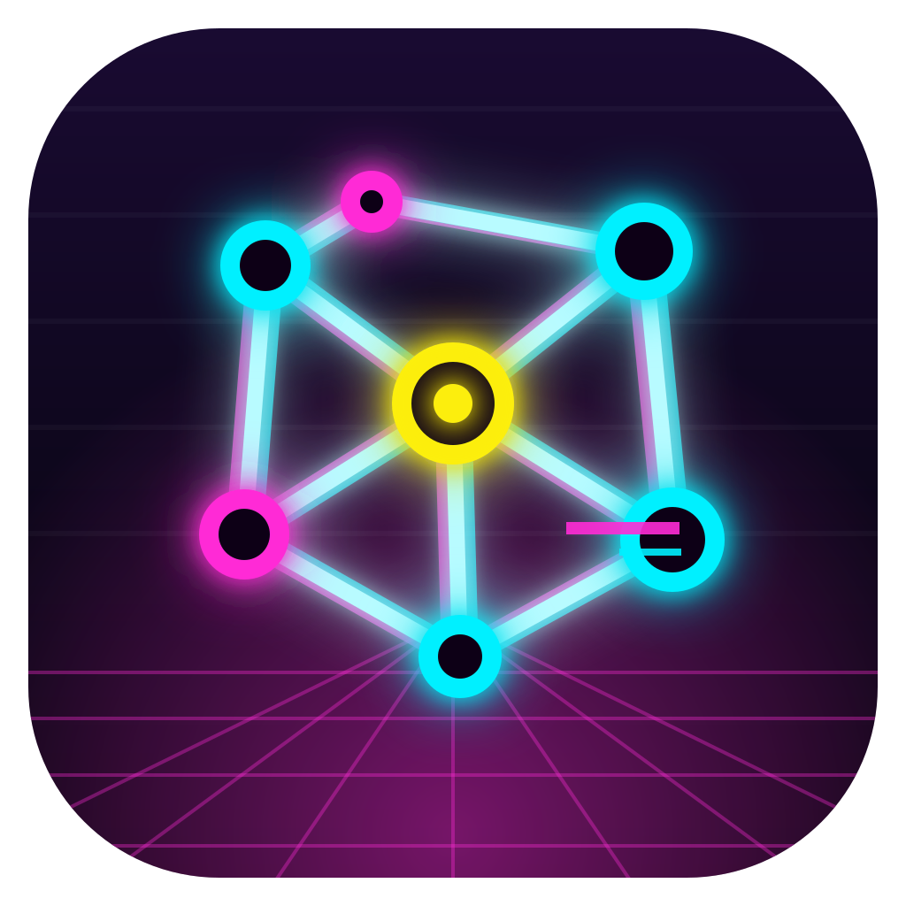
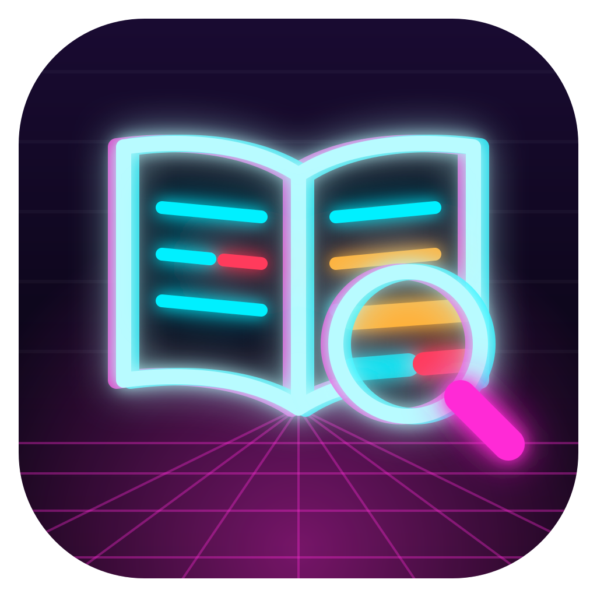
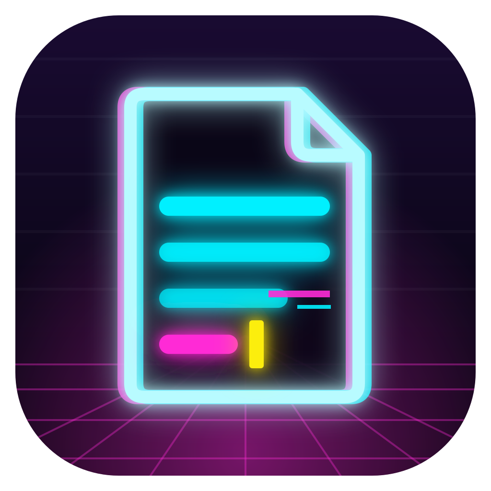
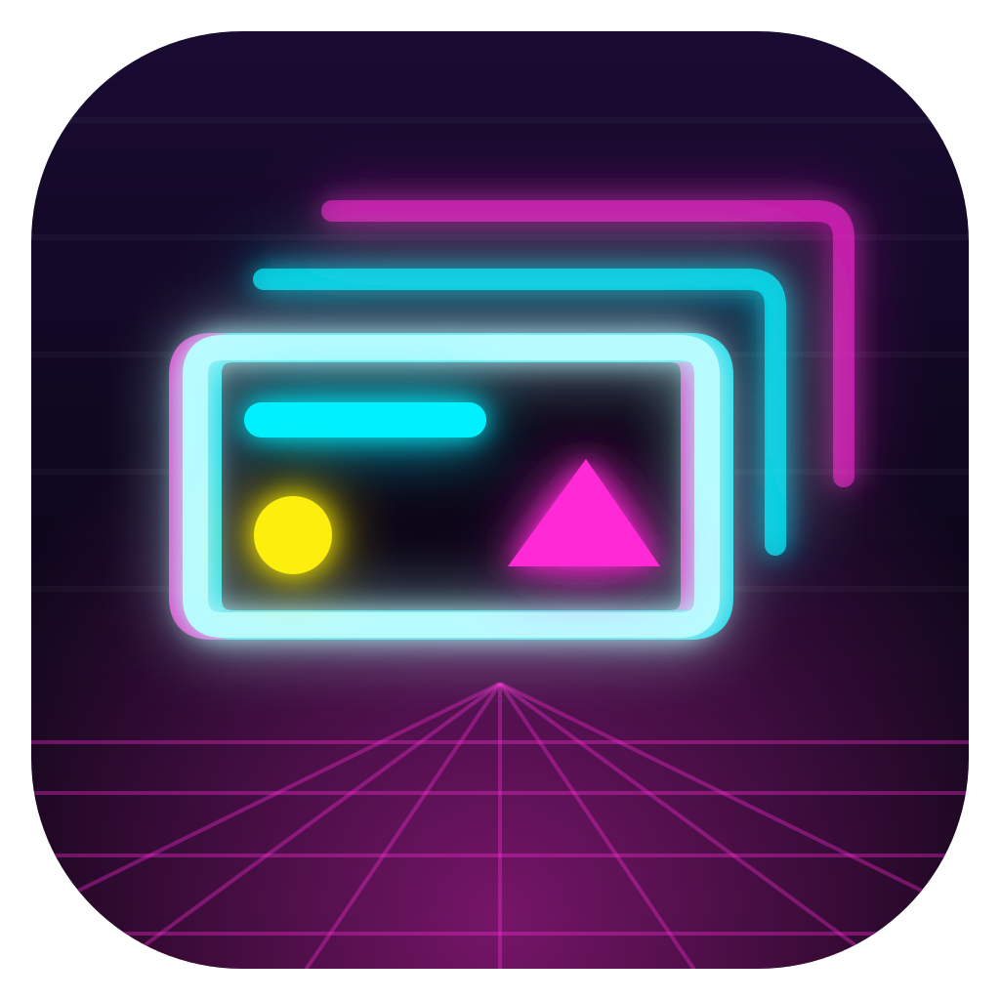
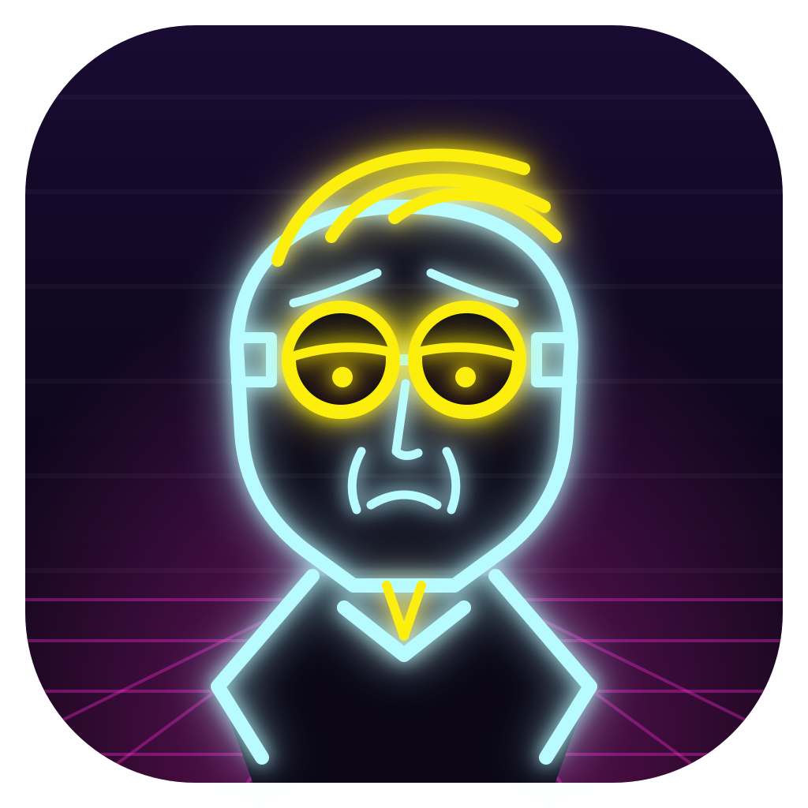
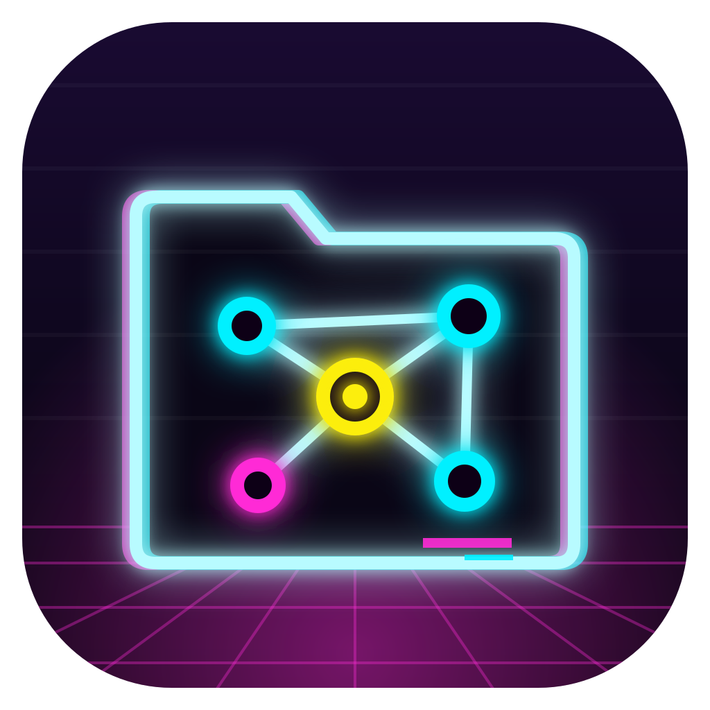
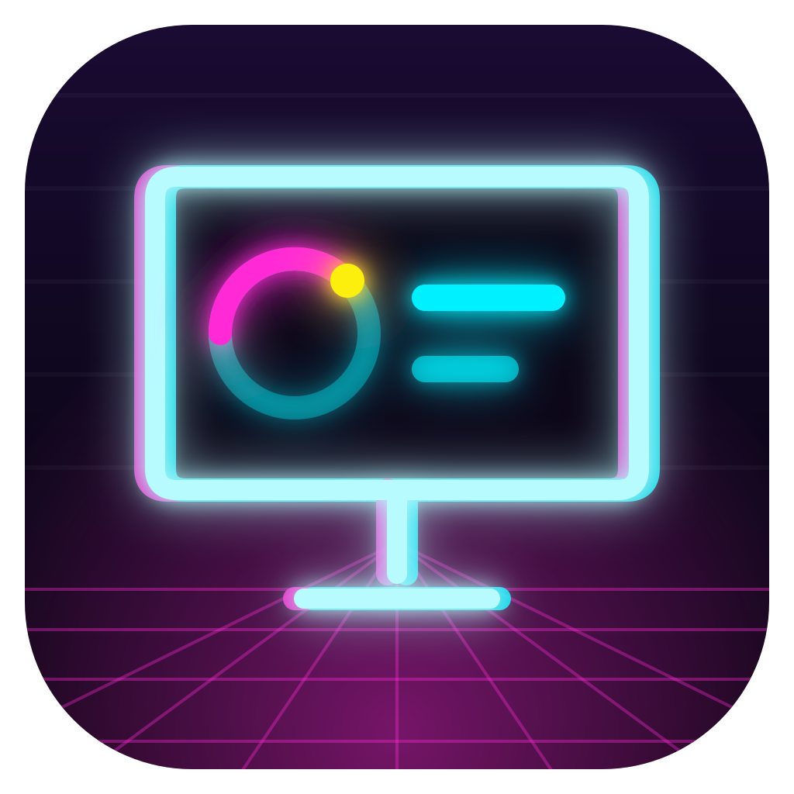
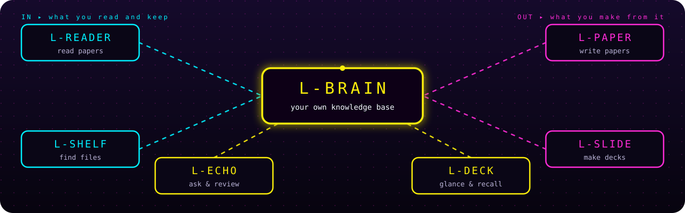

<a id="top"></a>
<p align="center">
  <a href="#03-the-apps"></a>
</p>

<p align="center">
  <b>Seven local-first apps that turn what you read into what you make.</b><br>
  Read a paper → keep what you understood → write the paper, build the deck → get quizzed on it later.<br>
  Everything runs on your own Mac (Rust + a web UI in a Tauri shell). Your data is plain files, synced with git.
</p>

<p align="center">
  <a href="#l-brain"></a>
  <a href="#l-reader"></a>
  <a href="#l-paper"></a>
  <a href="#l-slide"></a>
  <a href="#l-echo"></a>
  <a href="#l-shelf"></a>
  <a href="#l-deck"></a>
</p>

<p align="center">
  <a href="#l-brain"><b>L-Brain</b></a> ·
  <a href="#l-reader"><b>L-Reader</b></a> ·
  <a href="#l-paper"><b>L-Paper</b></a> ·
  <a href="#l-slide"><b>L-Slide</b></a> ·
  <a href="#l-echo"><b>L-Echo</b></a> ·
  <a href="#l-shelf"><b>L-Shelf</b></a> ·
  <a href="#l-deck"><b>L-Deck</b></a>
</p>

<p align="center">
  <sub>knowledge base · PDF reader · paper editor · slide editor · study partner · file catalog · desktop widgets</sub>
</p>

<p align="center">
  <a href="#01-what-this-is"><code>01 WHAT</code></a> ·
  <a href="#02-one-set-of-data-every-app"><code>02 SHARED DATA</code></a> ·
  <a href="#03-the-apps"><code>03 APPS</code></a> ·
  <a href="#04-quick-start"><code>04 QUICK START</code></a> ·
  <a href="#05-your-data-private"><code>05 YOUR DATA</code></a> ·
  <a href="#06-keys-and-models"><code>06 KEYS &amp; MODELS</code></a> ·
  <a href="#07-leak-guard"><code>07 LEAK GUARD</code></a> ·
  <a href="#08-going-deeper"><code>08 DEEPER</code></a>
</p>

<p align="center"><a href="#top" title="Back to top"></a></p>

## `01` What this is

LoreForge is one person's toolchain for research work, published as code. It is opinionated on purpose: the apps are the neutral machinery, and **everything that makes them yours lives in a private folder you own** (your cards, your sentence patterns, your slide styles, your fonts, the character you talk to).

<p align="center">
  <a href="#03-the-apps"></a>
</p>

- **L-Brain is the centre.** It is your personal database of what you know. The other apps ask it which terms you already remember. Cards an assistant drafts for you wait in an inbox until you confirm them.
- **Local first.** Each app is a small server on `127.0.0.1` with a static web UI, wrapped in a Tauri window. No account, no telemetry, no cloud storage.
- **Models are your choice.** Claude through your own subscription (Claude Code) or API key, or a local GGUF model through llama.cpp. One model choice is shared by every app.
- **One look.** Twenty colour themes (ten dark, ten light), chosen once and shown by every app.

> [!NOTE]
> This is a personal project under active development. Several apps are prototypes; the limits are listed with each app below. It is built and used on macOS (Apple Silicon). L-Paper also documents a Windows build; the rest are untested elsewhere.

<p align="center"><a href="#top" title="Back to top"></a></p>

## `02` One set of data, every app

The point of LoreForge is how tightly the apps share data. Office keeps each document to itself; here the same things are defined once and used everywhere.

| Shared | Defined once in | Used by |
|---|---|---|
| **Variables and symbols** | the notation registry (global, plus one per document) | L-Paper, L-Slide, L-Brain; L-Reader builds the same table for each paper you read |
| **Equations** | the notation registry, with the symbols each one uses | L-Paper (insert, `\ref`, check), L-Slide (native equations, live equation figures), L-Brain cards |
| **Knowledge cards** | L-Brain | L-Reader (marks what you know), L-Paper (skips or explains terms, inserts definitions), L-Slide (terms in a deck), L-Echo (answers and quizzes from them), L-Deck (review carousel) |
| **Papers, notes and quotes** | L-Reader | L-Paper (cite a saved sentence, write from papers), L-Slide (paper → deck) |
| **Your vocabulary, model choice, theme, fonts** | `private/shared/` | every app |

<p align="center"><a href="#top" title="Back to top"></a></p>

## `03` The apps

<a id="l-brain"></a>
<table><tr>
<td width="120" align="center"><a href="L-Brain/" title="Open the L-Brain folder"></a></td>
<td><h3>L-Brain</h3><b>Your own knowledge base: one card, one JSON file, and a record of whether you still remember it.</b><br><code>cd L-Brain && cargo run -p kb-server</code> → <code>http://127.0.0.1:7700</code><br><sub><a href="L-Brain/README.md">Full guide</a> · <a href="L-Brain/">Source</a> · <a href="private-example/KnowledgeBase/">Starter data</a> · <a href="commons/crates/kb-core/README.md">Core crate</a></sub></td>
</tr></table>

L-Brain exists to build a database that is specific to you. It is not a note dump: a card goes in only when you put it there, and each card carries your own learning state.

- **Cards as files.** `nodes/<id>.json` holds the content, `progress/<you>/<id>.json` holds your learning state. The search index (SQLite FTS5) lives in memory and is rebuilt from the files at every start.
- **Familiarity, not just storage.** Two on-time "remembered" answers (after 1 day, then 3 days) mark a card as known; forgetting resets it; known cards come back after 30 and 90 days; cards untouched for 180 days turn stale.
- **Links and a graph.** Cards link to each other; the graph view shows the whole base or one card's neighbourhood, coloured by domain, with a tag bar to light up one topic.
- **A pending inbox.** Cards drafted by L-Echo wait in a review area. You confirm, edit, merge into an existing card, or discard. L-Reader adds a card only when you press "Add to knowledge base".
- **Reminders.** Due-card notifications at times you set, and an optional daily e-mail digest with the questions first and the answers at the end.
- **A term scanner for the other apps.** Titles and aliases are matched in any text, so L-Reader can mark what you have not learned and L-Paper can skip explaining what you already know.

**Make it yours:** card kinds and their extra fields (`kinds.toml`), your domains and tag tree (`tags.json`), review intervals, reminder times, and separate spaces (a personal one, and a household one shared with family where each member keeps their own progress).

**Limits:** mounting a household space is not finished. Suggested candidate terms still come from an offline mock. The graph has twelve domain colours. iCloud image storage, real Gmail delivery and start-at-login have not been verified on real hardware.

<br>

<a id="l-reader"></a>
<table><tr>
<td width="120" align="center"><a href="L-Reader/" title="Open the L-Reader folder"></a></td>
<td><h3>L-Reader</h3><b>A PDF reader for papers that shows you what you do not know yet.</b><br><code>cd L-Reader && cargo run -p lr-server</code> → <code>http://127.0.0.1:7890</code><br><sub><a href="L-Reader/README.md">Full guide</a> · <a href="L-Reader/">Source</a> · <a href="private-example/LoreReader/">Starter data</a></sub></td>
</tr></table>

- **Knowledge marks.** Terms with no card in L-Brain are marked red; terms you have a card for show your familiarity.
- **Read with a pen.** Highlights, notes, free text boxes, and "quotes": sentences you save now and cite later from L-Paper.
- **Ask in place.** Select text to translate it, or ask Claude with the paragraph as context.
- **Term, symbol and equation tables.** One model call per paper sorts the unknown terms (method, metric, dataset, basic science and so on); the symbol and equation table is built without a model.
- **Page operations that never touch the original.** Delete, duplicate, reorder, insert from another PDF, merge. Each result is a new file.
- **Hand-offs.** Send the paper to L-Slide for a paper-report deck, or to L-Paper to write a review from it.
- **A library outside git.** PDFs are copied into `~/Documents/LoreReader/library`, named by their sha256. The app refuses a library inside any git work tree.

**Make it yours:** your field and level in `profile.toml` decide which words count as basic; `ignore-words.txt` holds words never to mark; `glyphs.toml` maps odd font glyphs to LaTeX; each task can use a different model.

**Limits:** prototype. It does not edit PDF content. Knowledge marks, adding cards and card summaries need L-Brain running; without it the reader says so and still marks red candidates.

<br>

<a id="l-paper"></a>
<table><tr>
<td width="120" align="center"><a href="L-Paper/" title="Open the L-Paper folder"></a></td>
<td><h3>L-Paper</h3><b>A LaTeX paper editor with no second window, and one registry for every symbol and equation you use.</b><br><code>cd L-Paper && cargo run -p pc-server</code> → <code>http://127.0.0.1:7878</code><br><sub><a href="L-Paper/README.md">Full guide</a> · <a href="L-Paper/">Source</a> · <a href="private-example/PaperComposer/">Starter data</a> · <a href="commons/crates/lore-notation/README.md">Notation registry</a></sub></td>
</tr></table>

- **LaTeX without the split screen.** You edit directly on the typeset page: text, equations, tables, figures and citations change where you see them. There is no source pane on one side and a preview window on the other, and no compile step between typing and seeing. The files underneath stay ordinary LaTeX.
- **The notation registry (對照表): the part that matters most.** Every symbol, equation, abbreviation, figure and table label is registered once, with its meaning, its macro and where it was defined. From then on:
  - you insert a symbol or an equation from the registry instead of retyping it, so the same quantity is always written the same way;
  - references are always `\ref{…}`, never a typed "Table 1";
  - a check pass (校對) finds undefined or unused symbols, abbreviations that are never expanded, and labels that are never referenced, and jumps to each place;
  - AI drafting, revision and polishing are held to the same registry: registered macros are locked before text is sent to a model, and a rewrite that drops or invents one is refused;
  - one global registry holds your habitual symbols and is shared by L-Paper, L-Slide and L-Brain; each paper adds its own.

- **Your sentence library.** Drafting retrieves patterns from your own collection and locks the tone to them. Hard rules (phrases to avoid, number style, comma splices) are checked by code, not by a model.
- **Journal templates.** Each template carries its submission rules: `Fig.` or `Figure`, caption position, page and word limits, double-blind.
- **In and out.** Open or import existing LaTeX and Word; export PDF (compiled with the journal's own class), LaTeX, or Word.
- **Also:** books written from papers you read in L-Reader, references and citation checks, review mode with tracked changes, living equations, flow figures, plots.

**Make it yours:** your notation registry, and the whole private workspace: `profile/` (sentence patterns, word choices, rules, example paragraphs), `style/` (your paragraph types and habits to avoid), `lens/` (what the drafting interview asks and when it has asked enough), `publishers/` (templates), `prompts/` (prompt overrides).

**Limits:** early development. The page is a live preview drawn with KaTeX; the PDF you submit is still compiled by a TeX installation (MacTeX, or BasicTeX plus a few packages listed in [the L-Paper guide](L-Paper/docs/guide.zh-TW.md)). Without a workspace it opens demo data.

<br>

<a id="l-slide"></a>
<table><tr>
<td width="120" align="center"><a href="L-Slide/" title="Open the L-Slide folder"></a></td>
<td><h3>L-Slide</h3><b>A task-driven slide editor with lossless PowerPoint files.</b><br><code>cd L-Slide && cargo run -p sc-server</code> → <code>http://127.0.0.1:7880</code><br><sub><a href="L-Slide/README.md">Full guide</a> · <a href="L-Slide/">Source</a> · <a href="private-example/SlideComposer/">Starter data</a> · <a href="docs/paper-deck.md">Paper → deck</a></sub></td>
</tr></table>

- **Lossless PPTX.** Open a `.pptx` where it lives; edits are written back to the same file. Untouched slides stay byte-identical, untouched objects keep their original XML. The original is backed up once before the first overwrite.
- **Styles as rules.** Text takes a style tag from the style pack instead of a free font and size; new colours must come from the palette. A deck stays consistent because it cannot drift.
- **Paper report.** Hand over a paper from L-Paper or L-Reader and get a planned deck: outline first, figures cropped to the module being explained, native tables and equations, references from cited keys.
- **Progressive reveal.** Pick steps on one slide and generate the build-up pages, with the other steps dimmed.
- **Presenting.** Presenter view on the laptop, audience view on the second screen, slide picker, laser, and equation figures you can run live during the talk.
- **Export.** PPTX and PDF.

**Make it yours:** style packs collected from your own decks or a company template (`styles/`), your own layouts (`arrangements/`), and example lines taken from your past decks so generated text sounds like you.

**Limits:** fonts not installed on the Mac are substituted, so some lines wrap differently than in PowerPoint. Picture effects, shadows and pattern fills are not drawn. Charts, SmartArt and OLE objects are kept but cannot be moved. PDF export needs Chrome; equations need pandoc.

<br>

<a id="l-echo"></a>
<table><tr>
<td width="120" align="center"><a href="L-Echo/" title="Open the L-Echo folder"></a></td>
<td><h3>L-Echo</h3><b>A study partner that sits in the corner of your desktop and knows what is in your knowledge base.</b><br><code>cd L-Echo && cargo run -p loreecho</code> (desktop bubble) · <code>cargo run -p le-server</code> → <code>http://127.0.0.1:7860</code><br><sub><a href="L-Echo/README.md">Full guide</a> · <a href="L-Echo/">Source</a> · <a href="private-example/LoreEcho/">Starter data</a> · <a href="docs/loreecho.md">Design</a></sub></td>
</tr></table>

- **A bubble that opens into a scene.** A small round bubble; click it and it becomes a visual-novel style window with a full-body character and the conversation.
- **Grounded in your cards.** Each turn brings the related L-Brain cards and how well you know them. Ask it to quiz you, to pick what to review today, or to mark something as remembered.
- **Voice.** Hold to talk or keep the microphone open; replies can be read aloud.
- **Turns talk into material.** Summarise the conversation into a LaTeX note for L-Paper, or into cards for L-Brain. Both show a preview and save only when you confirm.
- **Finds files.** With L-Shelf running, it can point to the file you mean.
- **Forgets by default.** Only the current conversation is kept in memory; the conversation itself is never saved to a file.

**Make it yours:** the character. `characters/<id>/` holds a `character.toml` (personality, background, speech style, catchphrases, what it calls you), avatar and full-body art for four states (idle, listening, thinking, speaking), a theme song, and the voice.

**Limits:** in development. Voice is macOS only. Through a Claude subscription replies arrive all at once (no streaming). It reads L-Brain directly but records "remembered" only while L-Brain is open.

<br>

<a id="l-shelf"></a>
<table><tr>
<td width="120" align="center"><a href="L-Shelf/" title="Open the L-Shelf folder"></a></td>
<td><h3>L-Shelf</h3><b>A catalog of the files on your Mac that only reads, unless you confirm a move.</b><br><code>cd L-Shelf && cargo run -p shelf-server</code> → <code>http://127.0.0.1:7900</code> · <code>cargo run --release -p loreshelf-cli -- scan ~/Downloads</code><br><sub><a href="L-Shelf/README.md">Full guide</a> · <a href="L-Shelf/">Source</a> · <a href="docs/loreshelf.md">Design</a></sub></td>
</tr></table>

- **Identity by content.** Files are recognised by sha256, so the catalog knows every place a file appears, which copies are duplicates, and which files exist only once.
- **Every date it can find.** Created, modified, downloaded, last opened, dates inside the document, and the download URL.
- **Projects as one unit.** A folder with `.git`, `main.tex`, `Cargo.toml`, `package.json` and similar counts as one project and is not read into.
- **Opens in the right app.** PDFs go to L-Reader, `.pptx` to L-Slide, `.docx` and `.tex` to L-Paper when they are installed.
- **Filing on your say.** It can plan where files belong; files move only in a batch you confirm, by rename only, with a journal and an undo.
- **Local only.** The catalog refuses to live in iCloud Drive, in this repo, or in a git repo with a remote.

**Make it yours:** which folders are scanned, and your own edits to the catalog, which are versioned separately from scan output.

**Limits:** scanning is read-only and never deletes. It does not follow symlinks or download iCloud placeholders. macOS may need a privacy permission for folders such as Downloads.

<br>

<a id="l-deck"></a>
<table><tr>
<td width="120" align="center"><a href="L-Deck/" title="Open the L-Deck folder"></a></td>
<td><h3>L-Deck</h3><b>Your macOS desktop as a canvas of widgets you write yourself.</b><br><code>cd L-Deck && ./build.sh install</code><br><sub><a href="L-Deck/README.md">Full guide</a> · <a href="L-Deck/">Source</a> · <a href="L-Deck/desktop/widgets/">Widgets</a></sub></td>
</tr></table>

- **Widgets are JS files, themes are CSS files.** Save the file and the desktop updates; no rebuild.
- **Built-in widgets.** System monitor, clock, alarm, calendar with reminders, news, launcher, and a carousel of L-Brain cards that also raises the due-card notification.
- **A layout per display resolution.** Drag to move, resize from the corner; a screen you have not arranged borrows the nearest layout, scaled.
- **Light on resources.** System numbers come from syscalls, sampling pauses when the desktop is covered, and only mounted widgets are computed.

**Make it yours:** everything. Copy `widgets/_template.js` for a new widget, copy a theme CSS for a new look, and set per-widget options in `layout.json`.

**Limits:** main display only. Alarms need L-Deck running and the Mac awake. A native Swift app for macOS 14 or later on Apple Silicon; with ad-hoc signing macOS may ask again for calendar and reminder access after each rebuild.

<p align="center"><a href="#top" title="Back to top"></a></p>

## `04` Quick start

You need [Rust](https://rustup.rs) and, for the Mac apps, the Tauri CLI.

```sh
git clone https://github.com/ellrin/LoreForge.git && cd LoreForge
sh scripts/install-hooks.sh                 # commit checks, see "Leak guard" below

cd L-Brain && cargo run -p kb-server        # run one app in the browser: http://127.0.0.1:7700
```

**Install the Mac apps** (builds, installs to `/Applications`, or `~/Applications` for L-Deck, and adds them to the Dock):

```sh
cargo install tauri-cli --version "^2" --locked
scripts/install-apps.sh                     # all seven
scripts/install-apps.sh L-Slide L-Brain     # or only some
sh scripts/set-default-apps.sh              # optional: .pdf → L-Reader, .pptx → L-Slide, .docx/.tex → L-Paper
```

| App | Folder | Browser mode | Port |
|---|---|---|---|
| L-Brain | [`L-Brain/`](L-Brain/) | `cargo run -p kb-server` | 7700 |
| L-Reader | [`L-Reader/`](L-Reader/) | `cargo run -p lr-server` | 7890 |
| L-Paper | [`L-Paper/`](L-Paper/) | `cargo run -p pc-server` | 7878 |
| L-Slide | [`L-Slide/`](L-Slide/) | `cargo run -p sc-server` | 7880 |
| L-Echo | [`L-Echo/`](L-Echo/) | `cargo run -p le-server` | 7860 |
| L-Shelf | [`L-Shelf/`](L-Shelf/) | `cargo run -p shelf-server` | 7900 |
| L-Deck | [`L-Deck/`](L-Deck/) | `./build.sh install` (native app) | none |

Each app is its own Cargo workspace and depends on the shared crates in [`commons/`](commons/) by relative path. On first run an app copies its starter content from `private-example/<App>/` into `private/<App>/` and from then on reads and writes only `private/`.

> [!IMPORTANT]
> The installed apps find `private/` from the LoreForge folder they were built in. Do not move the repo after installing; if you do, run `scripts/install-apps.sh` again.

<details>
<summary><b>Keep permissions across reinstalls: a local signing certificate</b></summary>

<br>

When the keychain has a code-signing certificate named "LoreForge Local", the install script signs the apps with it (otherwise ad-hoc). With a fixed identity, macOS remembers the microphone, personal voice and keychain permissions across reinstalls. Create it once per Mac. It is self-signed, needs no developer account, and the private key stays in the keychain:

```sh
cat > /tmp/lf.cfg <<'EOF'
[req]
distinguished_name = dn
x509_extensions = ext
prompt = no
[dn]
CN = LoreForge Local
[ext]
basicConstraints = critical,CA:false
keyUsage = critical,digitalSignature
extendedKeyUsage = critical,codeSigning
EOF
/usr/bin/openssl req -x509 -newkey rsa:2048 -nodes -keyout /tmp/lf.key -out /tmp/lf.pem -days 3650 -config /tmp/lf.cfg
/usr/bin/openssl pkcs12 -export -inkey /tmp/lf.key -in /tmp/lf.pem -name "LoreForge Local" -out /tmp/lf.p12 -passout pass:tmp
security import /tmp/lf.p12 -k ~/Library/Keychains/login.keychain-db -P tmp -T /usr/bin/codesign
rm /tmp/lf.key /tmp/lf.p12 /tmp/lf.cfg /tmp/lf.pem
```

</details>

<p align="center"><a href="#top" title="Back to top"></a></p>

## `05` Your data: `private/`

The code is in this public repo. Your data is not. `private/` is ignored as a whole, and each folder inside it is its own private git repo.

```
LoreForge/
  private-example/      public starter content, same layout as private/
  private/              never enters this repo
    shared/             settings every app reads
      profile.toml        who you are: id, display name, your field and level
      ui.toml             the colour theme, chosen once for all apps
      fonts.toml          interface fonts, substitutes for fonts you do not have, the fonts of generated decks
      engine.toml         the local model every app uses
      deny-words.txt      private words that must never be committed
    KnowledgeBase/      L-Brain: cards and learning state
    LoreReader/         L-Reader: notes, quotes and chats per paper (the PDFs live outside the repo)
    PaperComposer/      L-Paper: sentence library, templates, papers
    SlideComposer/      L-Slide: style packs, layouts, decks
    LoreEcho/           L-Echo: characters, window position, settings
```

Reading order is always `private/shared/<file>`, then `private-example/shared/<file>`. To personalise, copy a file from the example into `private/shared/` and change it; the public code and examples stay untouched. Licensed or company fonts are named only in your private `fonts.toml`, so they never appear in the public repo.

> [!NOTE]
> **About the names.** The apps were renamed to the `L-` family. Folders, windows and app bundles use the new names. Identifiers that existing data depends on keep the original ones: the `private/<App>/` folders above, `~/Library/Application Support/<App>/`, keychain services, environment variables (`KB_*`, `LOREREADER_*`, `PAPERCOMPOSER_*`, `SLIDECOMPOSER_*`), crate names and bundle ids.

<details>
<summary><b>Adding a new app</b></summary>

<br>

Use `commons/crates/lore-home` to find these places; never hard-code `../private`:

```rust
let home = lore_home::Home::discover(Path::new(env!("CARGO_MANIFEST_DIR")));
let data = home.seed_app("MyApp")?;           // private/MyApp, seeded once from private-example/MyApp
let prefs = home.prefs();                     // profile and fonts from private/shared
let extra = home.shared_file("my-app.toml");  // any new shared settings file
```

Add a `private-example/MyApp/` with the minimum the app needs to open. A web UI that links `/prefs.css` gets your interface fonts. `LOREFORGE_HOME` and `LOREFORGE_PRIVATE` point these locations elsewhere.

</details>

<p align="center"><a href="#top" title="Back to top"></a></p>

## `06` Keys and models

**No key, password or token is ever stored inside LoreForge**, public or private. Code that finds itself inside a git repository refuses to write a key file there.

| What | Where it lives | How to set it |
|---|---|---|
| Claude API key | macOS keychain: service `PaperComposer`, account `anthropic-api-key` | Paste it in L-Paper's settings. For development, `L-Paper/scripts/dev.sh` passes it as `ANTHROPIC_API_KEY` for that run |
| Claude subscription (Claude Code) | Claude Code's own sign-in (`claude`, `~/.claude`) | Run `claude` once and sign in. LoreForge stores nothing |
| Gmail SMTP app password | Keychain: service `KnowledgeBase`, account `smtp-password` | L-Brain's settings, or `KB_SMTP_PASSWORD`. If the keychain is unavailable: `~/Library/Application Support/KnowledgeBase/credentials.toml`, readable only by you |
| GitHub sync | The system git credential manager or `~/.ssh`; deploy keys in each app's settings folder | A normal `git` sign-in |
| Local models (`.gguf`) and llama.cpp | `LOCAL_LLM_HOME` (`<home>/gguf/<owner>/<repo>/`, `<home>/runtimes/llama.cpp/`); by default under `~/Library/Application Support/PaperComposer/` | The environment variable, or `local_llm_home = "…"` in L-Paper's `config.toml`. Models are downloaded from L-Paper's model page |
| App settings | `~/Library/Application Support/<App>/` | Each app's settings page. These files hold no passwords |

Local models run on one llama-server shared by the whole machine: whichever app needs it starts it, and the last one to finish stops it. See [`docs/local-models.md`](docs/local-models.md).

<p align="center"><a href="#top" title="Back to top"></a></p>

## `07` Leak guard

```sh
sh scripts/install-hooks.sh
```

This points the repo at `scripts/hooks/`. Before every commit:

1. Any file under `private/` is blocked.
2. Added lines containing a word from `private/shared/deny-words.txt` are blocked (whole word, case-insensitive). The list itself is private.
3. Files over 5 MB are blocked.
4. With [gitleaks](https://github.com/gitleaks/gitleaks) installed (`brew install gitleaks`), secrets are scanned.

A global `core.hooksPath` with a `commit-msg` hook still runs.

<p align="center"><a href="#top" title="Back to top"></a></p>

## `08` Going deeper

| | |
|---|---|
| [`commons/`](commons/) | Shared crates: model routing (Claude API, Claude Code, local), git sync, private data locations, the knowledge-base core, notation registry, PPTX read and write, the canvas, plots and flow figures |
| [`docs/`](docs/) | Design notes: the shared shell, local models, plots, flow figures, living equations, paper → deck, long papers, books |
| [`private-example/`](private-example/) | The starter content each app opens with |
| Each app's `README.md` | A short guide; the full one (繁體中文) is the app's `docs/guide.zh-TW.md` |

The interface language of the apps is Traditional Chinese.

## License

MIT, see [`LICENSE`](LICENSE).

## Development notes

This project is developed together with Claude (Anthropic); the code is written in claude.ai and Claude Code.
